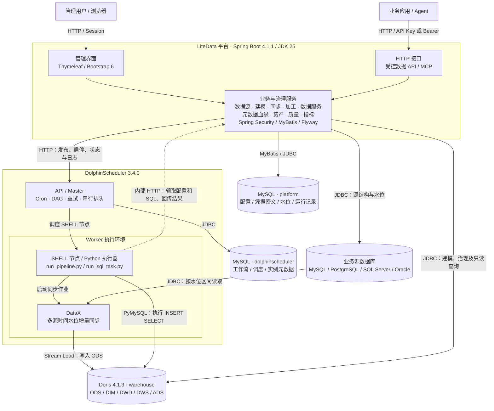

# LiteData

LiteData 是面向单机试点的数据中台：多数据库时间水位同步 → Doris 分层加工 → DolphinScheduler 工作流 → 受控数据 API。
仓库：[tan-wen/litedata](https://github.com/tan-wen/litedata)，版本 `0.1.0-SNAPSHOT`，尚未发布稳定版。
小数据真实链路已有历史验证，容量及连续运行须独立验收，见 [验证与验收](docs/engine-runbook.md#验证与验收)。

[文档索引](docs/README.md) · [图文操作手册](docs/user-manual.md) · [开发约定](CONTRIBUTING.md) · [生产部署](deploy/production/README.md)

## 能力

| 范围 | 当前实现 |
| --- | --- |
| 接入与建模 | MySQL / PostgreSQL / SQL Server / Oracle，自动 ODS、DIM/DWD/DWS/ADS、Doris DDL 和结构核对 |
| 加工与调度 | 独立 INSERT SELECT、依赖画布、定时和整链运行、运行互斥、实例及节点日志 |
| 数据治理 | 元数据与血缘、资产目录、18 类质量规则、三类指标及版本化字段血缘 |
| 数据服务 | 受控 SELECT、命名参数、发布/下线、凭证轮换、限流与调用审计 |
| 权限与界面 | ADMIN / DEVELOPER / VIEWER、Session/CSRF、用户 API Key/MCP、本地 Bootstrap 6、浅深主题与四套配色 |
| 交付与示例 | 开发一键启动、生产联网/离线包；[化工园区](examples/chemical-park/README.md)和独立 [DIM 示例](examples/chemical-park-dim/README.md) |

## 技术框架

平台管理配置、治理和状态，DolphinScheduler 调度编排，DataX 与 SQL worker 执行，Doris 承载分层数仓和查询。



平台技术基线：Spring Boot **4.1.1** / JDK **25** / MyBatis Starter **4.1.0** / Thymeleaf / Bootstrap **6.0.0-alpha.1**。
引擎固定版本及来源见 [运行说明](docs/engine-runbook.md#固定版本与来源)。Bootstrap 随应用提供，无需 CDN。
平台库 `platform` 与 DS 库 `dolphinscheduler` 使用独立账号；开发部署共用 MySQL 实例，生产部署拆分服务。
同步与加工由 DS 调度，质量扫描由平台 Spring 调度。具体进程划分见 [生产拓扑](deploy/production/README.md#拓扑与资源)。

## 启动

准备 Docker（Windows 使用 Linux 容器）和 Docker Compose v2。Windows 脚本需要 PowerShell 7，Linux/macOS 配置脚本需要 OpenSSL。
全栈在容器中构建应用；本地开发另需 JDK 25。首次构建需要访问 Docker Hub、GitHub 和 Maven Central。

```sh
git clone https://github.com/tan-wen/litedata.git
cd litedata
```

Windows（PowerShell 7）：

```powershell
.\deploy\start.ps1
```

Linux/macOS：

```sh
sh deploy/start.sh
```

脚本保留已有 `.env`，或生成随机凭据；启动平台库、演示源、Doris、DS/DataX 并完成引擎初始化。
打开 <http://localhost:8080>，用户 `admin`，初始密码见本地 `.env` 的 `PLATFORM_ADMIN_PASSWORD`。
该变量只用于首次创建账号，修改它不会覆盖已有账号密码。开发端口绑定本机，可在 `.env` 调整。
`docker compose ps` 查看状态，`docker compose down` 停止并保留数据卷。
已有旧部署先阅读 [目录与部署名称迁移](docs/engine-runbook.md#目录与部署名称迁移)。

## 订单演示

1. 在“数据源”登记并测试演示源：
   - URL：`jdbc:mysql://demo-mysql:3306/demo_source?useSSL=false&allowPublicKeyRetrieval=true&serverTimezone=UTC`
   - 用户/密码：`demo_reader` / `demo_reader_password`（仅演示库固定值）。
2. 在“数据建模”登记 ADS 模型 `ads_orders`，使用 UNIQUE、HASH(id)、固定 1 桶、1 副本；字段见 [初始化 SQL](deploy/dolphinscheduler/bootstrap-doris.sql)。演示物理表已存在，执行“结构比对”。
3. 在“同步管道”选择来源 `orders`、水位 `updated_at`，自动读取结构并创建 `ods_demo_orders`；核对预览并确认。首批从 1970-01-01 读取，ODS 不需另行手工录入字段。
4. 在“数据加工”创建以 `ads_orders` 为目标的独立任务：

   ```sql
   INSERT INTO ads_orders
   SELECT id, customer_name, amount, updated_at FROM ods_demo_orders
   ```

5. 在“工作流”创建以该加工任务为末端的工作流，在画布添加同步管道并连线到加工任务，保存后运行；通过运行实例确认本次各节点成功。按需在画布启用定时，避免为共享上游重复设置定时。操作与重试边界见 [数据加工](docs/sql-transforms.md)。
6. 在“数据服务”创建 `orders`，填写以下 SQL，发布并生成凭证（仅显示一次，重新生成会吊销旧凭证）：

   ```sql
   SELECT id, customer_name, amount, updated_at
   FROM ads_orders WHERE id = :id ORDER BY id
   ```

   ```sh
   curl -H 'X-API-Key: <生成的凭证>' 'http://localhost:8080/api/data/orders?id=1&pageNum=1&pageSize=100'
   ```

服务使用独立只读仓库账号，命名参数由 MyBatis 绑定。每服务凭证每分钟最多 60 次调用，总查询并发上限 8，超时 15 秒；限流和并发控制按单应用进程生效。
分页参数为 `pageNum`（默认 1）、`pageSize`（默认 100，范围 1–1000），这两个名称不能用作业务参数；SQL 须有稳定 `ORDER BY`。
返回 `data`、`count`、`pageNum`、`pageSize`、`hasMore`。调用明细包含成功和失败请求，日调用量按 Asia/Shanghai 统计。

## 开发与运行边界

开发检查见 [CONTRIBUTING](CONTRIBUTING.md#环境与验证)；生产 JAR + Compose、离线交付和备份恢复见 [生产部署](deploy/production/README.md)。
IDE 入口为 `com.litedata.PlatformApplication`，先启动依赖再导入本地环境变量。
主机运行平台时，将 `PLATFORM_DB_URL`、`DORIS_JDBC_URL`、`DOLPHINSCHEDULER_URL` 改为本机映射地址；容器内使用 Compose 服务名。
源库地址须同时被平台和 worker 访问，执行回调还需 worker 可达的 `PLATFORM_URL`。

时间水位、幂等、硬删除及迟到边界统一见 [执行与水位](docs/engine-runbook.md#执行与水位)。
模型只维护结构，数据需同步或加工写入；UNIQUE 覆盖不自动清理失效汇总行，见 [建模边界](docs/modeling.md#当前边界)。

```text
src/main/java/com/litedata/   按业务分包的 Java 源码
src/main/resources/          配置、Flyway、模板和静态资源
src/test/                    Java / JavaScript 测试
deploy/                      开发部署、worker、冒烟及生产交付
examples/                    可运行业务示例
docs/                        按模块维护的使用与运行说明
```

[Apache License 2.0](LICENSE) · [安全问题](SECURITY.md) · [变更记录](CHANGELOG.md) · [第三方声明](NOTICE)
