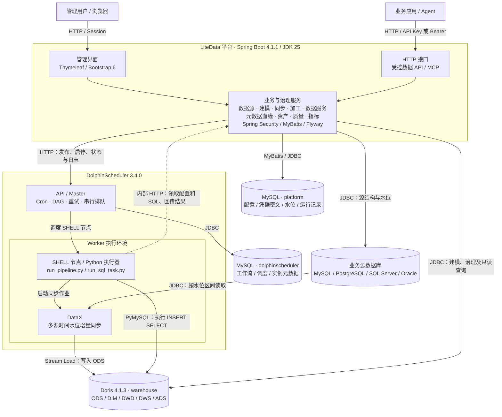

# LiteData

LiteData 是一个部署简单、易上手的数据中台，围绕多数据库按配置周期增量同步、Doris 幂等加工、DolphinScheduler 调度和受控数据 API 构建数据链路。

仓库：[tan-wen/litedata](https://github.com/tan-wen/litedata)。当前版本为 `0.1.0-SNAPSHOT`，
处于首版开发与引擎联调阶段。平台功能已有实现及自动化测试，演示同步及多层 SQL 加工链路已实测跑通，百万行压测和连续七天运行仍待验收。
详细范围见 [实施及验收计划](docs/implementation-plan.md)，操作与验证边界见 [引擎运行说明](docs/engine-runbook.md)。

图文上手手册：[可搜索网页版](docs/LiteData平台操作手册.html) · [Markdown 版](docs/user-manual.md) · [PDF 版](docs/manual/LiteData平台操作手册.pdf)。包含 39 个操作步骤，每步提供目的、示例、实际界面截图和结果检查。

## 项目能力

完整示例：[化工园区企业用能与单位产品能耗分析](examples/chemical-park/README.md)，包括模拟源、分层加工、质量纠错、三类指标、字段血缘、受控 API 和可交互看板。

独立 DIM 版本：[公共企业维度与单位产品能耗分析](examples/chemical-park-dim/README.md)，在同一业务场景增加 DIM 建模、SCD1 属性覆盖、成员与引用质量、维度字段血缘及专属看板；使用独立前缀和产物目录，可与原版对照运行。

后台采用 Helm 风格布局与本地固定版本的 Bootstrap 6（`6.0.0-alpha.1`），支持浅色、深色、跟随系统，以及海蓝、鸢紫、青绿、石墨四套配色，浏览器记住主题并支持浅深模式切换。

| 模块 | 当前实现 |
| --- | --- |
| 工作台 | 数据源、同步管道、数据服务统计及最近运行实例 |
| 数据源 | MySQL / PostgreSQL / SQL Server / Oracle JDBC 登记、凭据加密存储和连接测试；[接入说明](docs/data-sources.md) |
| 数据建模 | 分层/主题域、DIM 公共维度（业务键、展示字段、SCD1）、DIM/DWD/DWS/ADS 逻辑表与字段维护、标准备注、Doris DDL 预览、确认建表、结构比对、版本和执行记录 |
| 同步管道 | 自动读取来源结构、预览并创建 ODS，或接入已有 ODS；自定义分钟/小时/日/周 Quartz Cron、时间水位增量、运行互斥、执行实例及成功后推进水位 |
| 数据加工 | 独立 INSERT SELECT、同步/SQL 上游依赖、DAG 预览、整链运行、定时启停及节点执行记录 |
| 加工与调度 | DataX runner、Doris INSERT SELECT、DS 依赖工作流和定时启停、计划时间预览、平台内实例与节点日志；[调度运维说明](docs/scheduling-operations.md) |
| 数据服务 | 受控 SELECT、命名参数、发布/下线、凭证轮换、限流与调用审计 |
| 元数据与血缘 | 四类源数据库 / Doris 结构采集、元数据检索及字段详情、同步及 SQL 加工表级血缘、上下游追溯 |
| 资产目录 | 物理表、逻辑模型、指标与数据服务统一检索，数据库分页、业务描述、负责人、标签与敏感级别，关联结构、血缘和质量任务；[使用说明](docs/asset-directory.md) |
| 数据质量 | 多规则异常扫描、18类规则、时间窗口、阈值分级、手动/定时执行、配置快照及运行历史 |
| 指标管理 | 原子/复合/派生指标、SQL 预览、版本快照及归档保护；指标字段血缘可追溯聚合、维度、筛选、加工及同步来源；[使用说明](docs/metrics.md) |
| 账号权限 | ADMIN / DEVELOPER / VIEWER，管理页面 Session 登录与 CSRF 防护 |
| MCP / Agent | 用户级 API Key、有效期与吊销、scope 和资源白名单、逐次权限校验；[方案与接入说明](docs/mcp.md) |
| 性能与容量分析 | 通用数据中台与 LiteData 视角下 [Doris 瓶颈与部署模式能力对比](docs/doris-capacity-and-bottlenecks.md) |

所有资源的列表、新增、编辑使用独立页面。列表默认每页20条，可切换每页条数及前后翻页，显示记录总数；模型筛选条件在翻页时保留。数据源与服务页默认限制每页 20 条，新增和编辑等页面独立路由，不内嵌弹窗。

## 技术框架

平台负责配置、治理和运行状态管理，DolphinScheduler 负责同步与加工任务的调度编排，
DataX 与 SQL 执行器完成数据读写，Doris 承载分层数仓及查询。



- **同步与加工**：典型链路为 DataX 写入 ODS，再由独立 SQL 任务清洗、关联或汇总到 DIM/DWD/DWS/ADS。
  DS 节点实际类型为 `SHELL`；SQL 保存在平台，执行器运行时通过内部 HTTP 接口领取 SQL 快照，执行后回传结果。
- **状态与调度**：平台维护运行互斥和同步水位，成功回调后才推进水位；加工失败不回退同步水位。
  同步与加工使用 DS 调度，数据质量扫描使用平台内置 Spring 调度，扫描范围为 MySQL 数据源与 Doris。
- **元数据隔离**：平台库 `platform` 与 DS 库 `dolphinscheduler` 使用独立账号；默认开发部署共用一个 MySQL 实例，
  生产部署拆分为独立 MySQL 服务。图中按逻辑职责展示，具体进程与容器划分见 [生产部署说明](deploy/production/README.md)。

技术基线：Spring Boot **4.1.1** / JDK **25 LTS** / Thymeleaf / MyBatis Starter **4.1.0** /
Bootstrap **6.0.0-alpha.1** / MySQL **8.4.11**。Bootstrap 随应用提供，运行时无需访问 CDN。
固定引擎版本为 Doris **4.1.3**、DolphinScheduler **3.4.0**，DataX 固定源码提交见运行说明。
Java 根包为 `com.litedata`，Maven 坐标为 `com.litedata:litedata`。

## 启动

准备 Docker（Windows 使用 Linux 容器）和 Docker Compose v2；Windows 脚本需要 PowerShell 7，
Linux/macOS 配置生成脚本需要 OpenSSL。全栈启动会在容器中构建应用，本地开发和测试另需 JDK 25。
首次启动需要下载并构建多个引擎镜像，请为 Docker 预留相应内存和磁盘空间。

```sh
git clone https://github.com/tan-wen/litedata.git
cd litedata
```

Windows（PowerShell 7）：

```powershell
.\deploy\start.ps1
```

Linux/macOS：

```sh
sh deploy/start.sh
```

脚本自动生成本地 `.env`，启动两个 MySQL、Doris 和包含 DataX 的调度节点，初始化独立调度库、
仓库表和读写账号，创建 DS 项目及令牌，最后构建并启动平台。
已有 `.env` 会保留。首次构建需要访问 Docker Hub、GitHub 和 Maven Central。

打开 <http://localhost:8080>，用户名 `admin`，初始密码在本地 `.env` 的
`PLATFORM_ADMIN_PASSWORD` 中。该密码只在账号首次创建时使用；修改环境变量不会覆盖已有账号密码。
所有开发端口绑定本机，凭据文件已被 Git 和 Docker 构建上下文忽略。
端口可在 `.env` 调整。`docker compose ps` 查看状态，`docker compose down` 停止服务并保留数据卷。
已有环境迁移时请先阅读 [目录与部署名称迁移](docs/engine-runbook.md#目录与部署名称迁移)。

## 跑通演示

1. 在“数据源”登记固定演示库并测试连接：

   - 名称：演示源
   - URL：`jdbc:mysql://demo-mysql:3306/demo_source?useSSL=false&allowPublicKeyRetrieval=true&serverTimezone=UTC`
   - 用户：`demo_reader`，密码：`demo_reader_password`

2. 在“数据建模”登记 `ads_orders`（ADS），使用 UNIQUE、HASH(id)、固定 1 桶、1 副本；字段结构见 `deploy/dolphinscheduler/bootstrap-doris.sql`。演示物理表已初始化时，执行“结构比对”确认一致。ODS 无需在此手工填写字段。

3. 在“同步管道”创建任务：

   - 来源表：`orders`，水位字段：`updated_at`
   - 接入方式：自动读取结构并创建 ODS；目标表：`ods_demo_orders`
   - 点击“读取结构并预览 ODS”，核对自动读取的主键、字段和 DDL，再勾选确认创建；模型和元数据由平台登记。
   - 调度：`0 0 * * * ?`
4. 在“数据加工”创建独立 SQL 任务，目标选择已建 ADS 模型，填写 `INSERT INTO ads_orders SELECT id, customer_name, amount, updated_at FROM ods_demo_orders`，并声明该同步管道为上游依赖。

5. 从 SQL 任务运行整条依赖链，等待真实实例成功；定时建议只在末端 SQL 任务启用。首批同步会读取从 1970-01-01 起的全部数据。
6. 在“数据服务”创建 `orders`，查询：

   ```sql
   SELECT id, customer_name, amount, updated_at
   FROM ads_orders WHERE id = :id ORDER BY id
   ```

   发布服务并生成一次性显示的凭证；每次重新生成会吊销旧凭证。

7. 调用：

   ```sh
   curl -H 'X-API-Key: <生成的凭证>' 'http://localhost:8080/api/data/orders?id=1&pageNum=1&pageSize=100'
   ```

服务固定使用只读仓库账号，命名参数由 MyBatis 绑定。每服务凭证每分钟最多 60 次调用，
总查询并发上限 8，查询超时 15 秒。分页固定使用 `pageNum`（默认 1）和 `pageSize`（默认 100，范围 1–1000），
这两个名称不能用作 SQL 业务参数。查询 SQL 必须使用稳定的 `ORDER BY` 保证跨页顺序一致。
返回 `data`、`count`、`pageNum`、`pageSize` 和 `hasMore`，不返回 `total` 或 `truncated`。服务列表的日调用量按
Asia/Shanghai 当天统计，包含成功和失败请求；每个服务可进入调用记录查看时间、状态、耗时和分页元数据。

## 数据建模

公共维度提供 DIM 分层、复合业务键、展示名称字段、维度属性与 SCD1 当前值覆盖策略，见[公共维度建模](docs/dimension-models.md)。

打开“数据建模”，定义主题域、ODS/DIM/DWD/DWS/ADS 分层、物理表名及字段；键列排在前面且不可空。
字段类型通过下拉选择，CHAR/VARCHAR、DECIMAL、DATETIME 按需单独设置长度或精度。
表单按“模型信息 → 字段定义 → Doris 物理设置”三步进行，后续提示与选项根据分层、键列和字段类型收敛。
目标库固定为 `warehouse`，可选择 UNIQUE、DUPLICATE、AGGREGATE 模型、副本数及可选的日/月/年日期自动分区。
第三步支持自动 RANGE / LIST、手动 RANGE / LIST 和动态时间分区；动态属性可在 textarea 编辑完整 PROPERTIES。
AGGREGATE 的非键列在第三步指定聚合函数；默认 UNIQUE、单副本、不分区，新表默认 HASH 按全部键列自动分桶（BUCKETS AUTO），也可自选分桶键和手动桶数；DUPLICATE 另支持 RANDOM 随机分桶。
已有表保留原固定桶数；自动分桶只在建表或创建新分区时推断，不自动重分桶已有数据。
保存后进入 DDL 预览，勾选确认后执行 Doris 建表；当前单 BE 开发环境副本数使用 1。
已有表可“结构比对”，覆盖字段、键列、聚合函数、数据模型、默认副本、自动/手动/动态分区规则及分桶方式、键和数量策略；
表/模型说明、标准备注、已生成分区列表和各分区单独覆盖的属性不属于比对范围。
已有保存表名固定；编辑模型会增加版本，提交过期页面会被拒绝。归档保留物理表、字段和执行记录。

**建表与数据写入是两个步骤。** 当前自动同步与重试加工要求 UNIQUE 目标；DUPLICATE / AGGREGATE 的写入及重算由独立作业管理。
UNIQUE 模型的 ODS 数据由同步管道通过 DataX 从业务库接入；DIM/DWD/DWS/ADS 数据
通过独立“数据加工”的 `INSERT INTO ... SELECT` 清洗、关联或汇总写入。声明直接上游 SQL 任务
或同步管道后，系统展开完整依赖链，交由 DolphinScheduler 按上游成功后执行下游；可手动整链运行，
或在末端启用每 5 分钟、每小时、每日的定时调度。保存逻辑模型不会自动产生数据。
同步管道只允许写入已登记的 ODS UNIQUE 模型，不再新增或编辑同步后 SQL。清洗、关联、汇总均由独立“数据加工”任务完成；建议只在末端任务启用定时。旧管道 SQL 必须先迁移为独立任务，迁移期间保留归档和运行记录。使用及实际验收见 [数据加工](docs/sql-transforms.md)。
汇总重算涉及删除/失效的结果时需另行设计覆盖或分区替换策略，单靠主键 UPSERT 不能清理旧结果。

建表使用 `DORIS_WRITER_USER` / `DORIS_WRITER_PASSWORD`，初始化脚本在 `warehouse.*` 授予
`CREATE_PRIV`；API 查询及结构读取继续使用独立只读账号。已有环境的升级步骤与验证脚本见
[数据建模说明](docs/modeling.md)。

## 数据治理

打开“数据治理 → 资产目录”，统一发现物理表、逻辑模型、指标和数据服务，按类型、主题域、负责人、标签及状态筛选，在详情查看结构、血缘、质量任务和使用入口。管理员与开发者可通过独立页面维护业务描述；目录标签不改变现有数据访问权限。范围和状态语义见 [资产目录说明](docs/asset-directory.md)。

打开“数据治理 → 元数据与血缘”，先采集 Doris 数仓或已登记的数据源，在表详情查看字段及表级血缘。
血缘依据当前同步管道和 SQL 加工的读写表生成，支持方向、展开层数、缩放及关联任务跳转。
结构采集失败保留原快照，未再发现的表会标记；当前为手动采集、最新结构快照及表级血缘。
采集权限、版本和解析范围见 [元数据与血缘说明](docs/metadata-lineage.md)。

打开“数据治理 → 数据质量”，为 Doris 或已登记的 MySQL 数据源配置扫描任务。支持18类规则组合、异常条数与比例容忍、时间窗口、手动运行及平台内置 Cron 调度。运行历史区分数据异常与执行错误，保留配置快照和统计；规则语义、时区及调度边界见 [数据质量说明](docs/data-quality.md)。

## 本地开发和验证

生产单机的 JAR + Docker Compose 部署包及打包入口见 [生产部署说明](deploy/production/README.md)，
按 32 核 / 128GB、独立 Doris FE/BE 和分进程 DolphinScheduler 配置，支持联网/离线交付、凭据初始化、持久化和备份恢复。

使用 JDK 25 和仓库自带的 Maven Wrapper（Maven 3.9.11），无需安装全局 Maven。
自动化测试由 Testcontainers 启动真实 MySQL，需要 Docker；不需要先配置 `.env` 或启动完整引擎。

```powershell
.\mvnw.cmd verify
```

```sh
./mvnw verify
```

测试验证数据库迁移、页面、鉴权、凭据、SQL 策略和水位状态；不验证真实 DataX、Doris 和 DS 调度链路。

```sh
docker compose --env-file .env.example config --quiet
```

IDE 启动入口为 `com.litedata.PlatformApplication`。先启动依赖，再将本地 `.env` 配置导入 IDE 环境。
平台在主机运行时，`PLATFORM_DB_URL`、`DORIS_JDBC_URL` 和 `DOLPHINSCHEDULER_URL` 须改为对应的本机映射地址。
平台在容器内运行时使用 Compose 服务名。源库地址必须同时能被平台和执行 worker 访问；
单独使用 `localhost:3307` 只适用于主机连接测试，容器 worker 的 `localhost` 指向自身。
涉及执行回调的本机调试还需单独配置 worker 可达的 `PLATFORM_URL`；完整链路优先使用 Compose 运行平台。

完整引擎验收步骤和已知验证状态见 [引擎运行说明](docs/engine-runbook.md) 和
[实施及验收计划](docs/implementation-plan.md)。

## 仓库结构

```text
src/main/java/com/litedata/   启动入口、config、data、model、pipeline、security、service、store、web
src/main/resources/          应用配置、Flyway 迁移、Thymeleaf 模板、Bootstrap 与样式
src/test/java/com/litedata/   单元测试和真实 MySQL 集成测试
deploy/                     环境生成、引擎初始化、worker、演示数据、冒烟及容量验收脚本
docs/                       实施范围和引擎操作说明
.github/                    CI 和贡献模板
compose.yaml / Dockerfile   单机开发部署与应用构建
AGENTS.md                   项目上下文和代理协作约定
```

## 数据语义

- 源表需有非空、带前导索引的 DATETIME/TIMESTAMP 水位字段；新增和更新必须更新该字段。
- 每批按源库时间获取上界，回读最近成功水位之前 5 分钟；DataX 成功写入 ODS 后才推进水位，独立 SQL 失败不回退它。
- 同步目标必须是已登记的 ODS UNIQUE 模型；加工目标也应使用适合其幂等写入语义的业务主键。
- 时间水位覆盖有限迟到。硬删除和超出重放窗口的历史变更需要单独对账及补数。
- 意外中断导致实例仍为 RUNNING 时，应先在 DS 确认任务及子进程停止，再按运行说明恢复。
- 百万行每小时是验收目标，需完成真实同步、加工及对账压测后才能确认。
- 限流和查询并发控制在单个应用进程内生效；当前部署按单实例设计。

## 开源

[Apache License 2.0](LICENSE)。贡献与验证方式见 [CONTRIBUTING](CONTRIBUTING.md)，
安全问题见 [SECURITY](SECURITY.md)，版本变更见 [CHANGELOG](CHANGELOG.md)，
项目上下文和代理协作入口见 [AGENTS](AGENTS.md)，第三方说明见 [NOTICE](NOTICE)。
非敏感缺陷和功能建议请提交到 [Issues](https://github.com/tan-wen/litedata/issues)。

本仓库从原 `bigdata` 工作目录拆出开源工程，早期原型、设计原稿、Excel 计划和功能图保留在原目录，
不随此仓库发布。当前实现范围以源码和 `docs/` 为准；本地 `.env`、运行凭据、日志和构建产物不入库。
