# LiteData 平台操作手册

> 版本：2026-10-26；适用平台：0.1.0-SNAPSHOT。包含 39 个图文步骤。截图来自实际运行界面；未提交表单和既有结果均在步骤中注明。

[打开可搜索的网页版](LiteData平台操作手册.html)

[下载 PDF 版（45 页）](manual/LiteData平台操作手册.pdf)

## 使用前提

平台已经部署，能够登录。维护及执行任务需 ADMIN / DEVELOPER；账号管理需 ADMIN。首次部署按仓库 README 执行 deploy/start.ps1 或 deploy/start.sh。

首次 orders 链路使用已初始化的 ods_orders / ads_orders；园区进阶样例对应 examples/chemical-park-dim/README.md，截图中的前缀为 cpdim_resin261026b。新建表练习使用独立表名 ods_orders_manual，不与已有订单链路混用。

## 目录

- 01 开始使用：步骤 01–03
- 02 数据源：步骤 04–05
- 03 数据建模：步骤 06–10
- 04 同步与调度：步骤 11–15
- 05 数据加工：步骤 16–18
- 06 数据服务：步骤 19–21
- 07 元数据与资产：步骤 22–26
- 08 数据质量：步骤 27–30
- 09 指标管理：步骤 31–35
- 10 账号与 Agent：步骤 36–39

## 01 登录平台

**目的**：进入管理工作台，取得与本人角色对应的操作入口。

**操作**：

1. 浏览器打开管理员提供的平台地址；本地默认 http://localhost:8080。
2. 填写用户名和密码，点击“登录工作台”。
3. 若登录失败，先核对账号和密码，再联系管理员。

**示例**：本地初始用户为 admin；初始密码由部署管理员从本地配置中获取，不在手册中公开。

**结果检查**：登录成功后进入工作台，并显示当前角色允许的菜单。

**操作提醒**：平台须已完成部署。本手册的截图来自本地运行环境；密码输入区域已遮蔽。

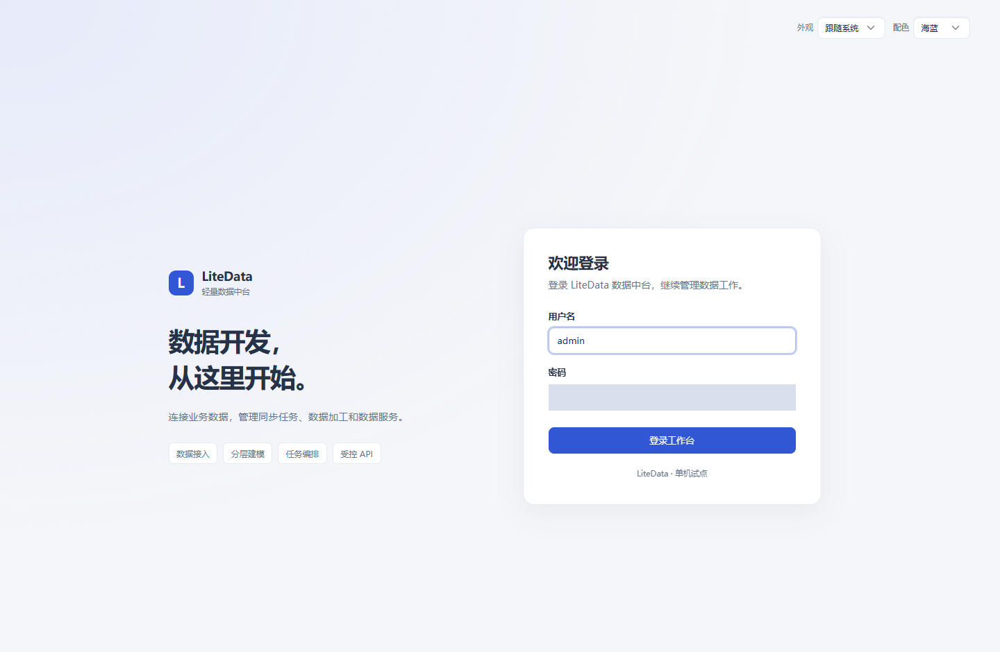

*图 01：登录页；密码区域已遮蔽；页面 `/login`。*

## 02 认识工作台与操作主线

**目的**：建立从数据接入到业务使用的整体路径。

**操作**：

1. 查看左侧“数据开发”和“数据治理”分组。
2. 在工作台查看资源统计和最近运行记录。
3. 按数据源 → 建模 → 同步 → 加工 → 服务的顺序完成首次链路。

**示例**：进阶示例采用仓库内“公共企业维度与单位产品能耗分析”：ODS → DIM / DWD → DWS → ADS。

**结果检查**：能找到数据源、数据建模、同步管道、数据加工、数据服务和各治理菜单。

**操作提醒**：截图中 cpdim_resin261026b 为合成演示数据前缀；实际资源 ID、数量和运行时间以自己的环境为准。

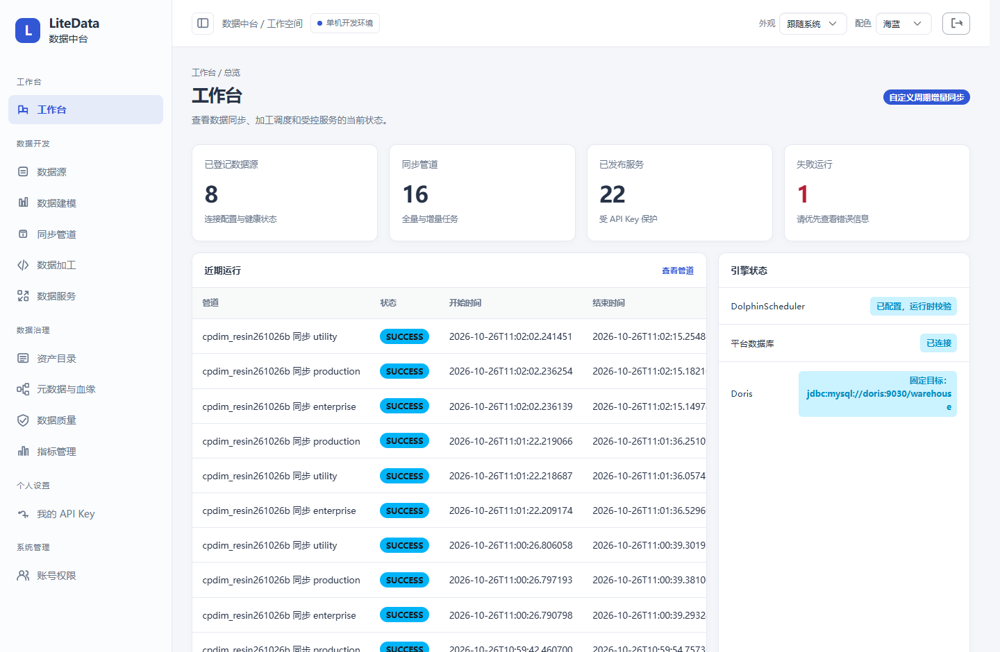

*图 02：LiteData 实际页面截图（局部）；页面 `/`。*

## 03 调整外观并使用统一列表

**目的**：选择适合自己的阅读方式，理解列表筛选与分页。

**操作**：

1. 在右上“外观”选择浅色、深色或跟随系统。
2. 使用“配色”选择海蓝、鸢紫、青绿或石墨。
3. 列表中先筛选，再翻页；通过“每页”调整条数并点击“应用”。

**示例**：示例：外观选择“深色”，配色使用“海蓝”。

**结果检查**：外观立即变化，浏览器记住选择；列表显示总数、页数和前后翻页入口。

**操作提醒**：各资源新增、编辑均打开独立页面。遇到没有维护按钮的账号，请核对是否为只读用户。

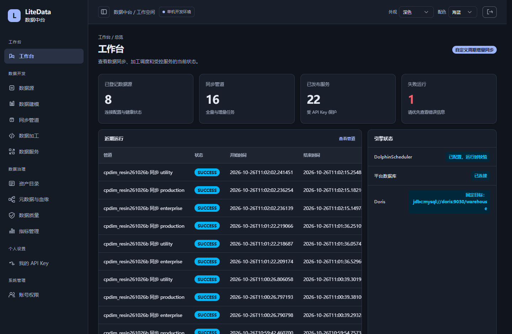

*图 03：LiteData 实际页面截图（局部）；页面 `/`。*

## 04 新增业务数据源

**目的**：登记平台和执行节点都能访问的业务数据库。

**操作**：

1. 进入“数据源”，点击“新增数据源”。
2. 填写名称、用户名、数据库类型和 JDBC 地址；输入管理员提供的密码。
3. 点击“保存数据源”，返回列表。

**示例**：演示库：MySQL；用户 demo_reader；JDBC 地址见截图。测试库密码由部署管理员按 README 提供。

**结果检查**：保存后列表出现新数据源，连接状态等待测试。

**操作提醒**：截图为填写示例，未提交。容器 worker 的 localhost 指向自身；Compose 演示库应使用 demo-mysql 服务名。

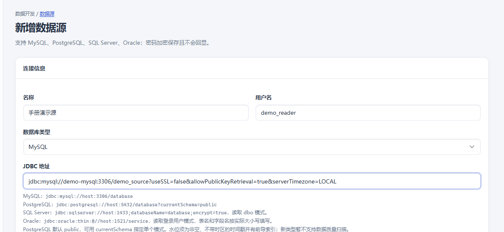

*图 04：LiteData 实际页面截图（局部）；页面 `/sources/new`。*

## 05 测试连接并检查状态

**目的**：确认连接可用，再配置同步或采集。

**操作**：

1. 在数据源列表找到目标记录。
2. 点击该行“测试连接”。
3. 检查状态和最近错误；失败时检查网络、库名、账号及驱动类型。

**示例**：已有演示源“cpdim_resin261026b 化工园区业务源”显示 CONNECTED。

**结果检查**：连接成功显示 CONNECTED；失败需查看脱敏错误后修正。

**操作提醒**：截图展示既有演示源的连接结果，本次采集未重新测试。连接可用仍不等于 worker 运行链路已通过。

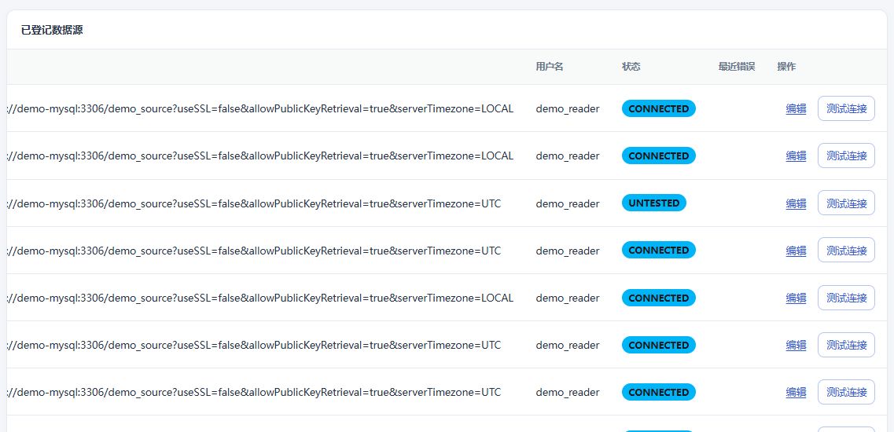

*图 05：数据源列表已横向滚动到连接状态和操作列；页面 `/sources`。*

## 06 创建逻辑模型

**目的**：先定义仓库表结构，再执行建表和数据写入。

**操作**：

1. 进入“数据建模”，点击“新增模型”。
2. 第一步填写物理表名、中文名称、主题域、数仓分层和说明，再点击“下一步”。
3. 首次练习使用独立表名，避免覆盖已有模型。

**示例**：物理表名 ods_orders_manual；中文名称 手册订单原始表；主题域 交易；分层 ODS；新表默认自动分桶。

**结果检查**：模型基本信息完整；下一步继续定义字段。

**操作提醒**：截图为未保存的新建表单。物理表名首次保存后固定；目标数据库固定为 warehouse。

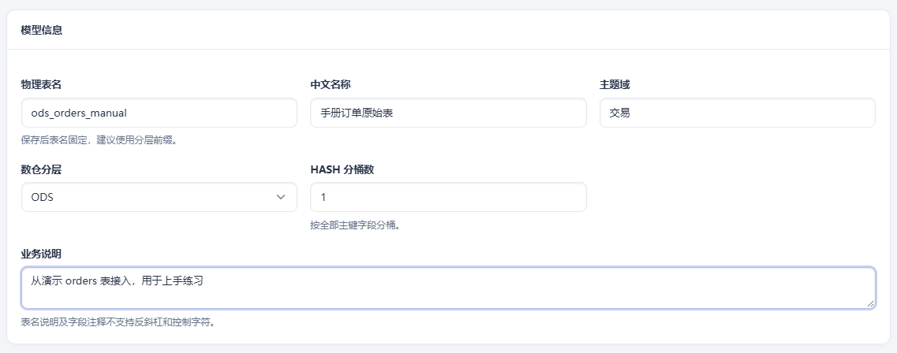

*图 06：LiteData 实际页面截图（局部）；页面 `/models/new`。*

## 07 添加字段并设置主键

**目的**：保证业务键和类型能够支撑幂等写入。

**操作**：

1. 第二步“字段定义”点击“添加字段”，录入字段名、注释和标准备注，通过下拉框选择数据类型。
   CHAR/VARCHAR 单独填写长度，DECIMAL 设置总位数和小数位，DATETIME 选择时间精度；无需手写类型表达式。
2. 勾选业务主键，确保所有主键连续位于字段最前且不可空。
3. 按源表补齐字段后进入第三步“Doris 物理设置”，参考分层提示选择表模型、副本及可选分区。
   分区字段只列出前一步的 DATE / DATETIME 键列；选择 AGGREGATE 后在本步配置每个非键字段的聚合函数。
4. 新表默认自动分桶，无需填写桶数。检查前两步摘要后点击“保存并预览 DDL”。

**示例**：最小演示：id BIGINT 主键、不可空；updated_at DATETIME(6)、不可空。真实 orders 还需 customer_name、amount 等源列。

**结果检查**：保存后进入模型详情，显示字段定义和自动生成的 DDL。

**操作提醒**：图中仅展示字段编辑方式，不是完整 orders 同步结构；同步前必须按实际源列补齐目标表。STRING 和浮点类型不能作为主键。

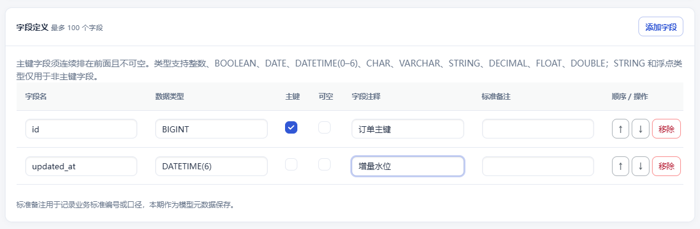

*图 07：LiteData 实际页面截图（局部）；页面 `/models/new`。*

## 08 检查 Doris DDL 预览

**目的**：执行建表前核对目标、主键和字段类型。

**操作**：

1. 打开已保存模型详情。
2. 查看“Doris DDL 预览”。
3. 核对 warehouse 库、数据模型（UNIQUE / DUPLICATE / AGGREGATE）、键列、HASH 分桶、默认副本及可选日期自动分区。
4. AGGREGATE 逐一核对非键字段的聚合函数。新建/编辑页的“Doris 物理设置”可调整这些配置；截图示例沿用 UNIQUE 单副本。

**示例**：既有样例：cpdim_resin261026b_ods_utility；主键 record_id；水位 updated_at DATETIME(6)。

**结果检查**：DDL 与模型字段一致，目标表名、主键和桶数符合预期。

**操作提醒**：截图使用已经建好的园区演示模型。DDL 由服务端生成，页面不接受任意 DDL 脚本。
当前同步回放和自动重试加工目标仍须 UNIQUE；DUPLICATE / AGGREGATE 需独立管理写入与重算，具体见[数据建模](modeling.md)。

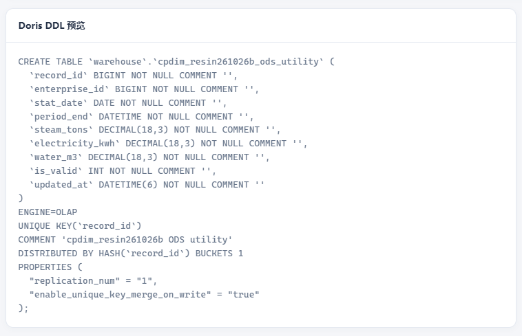

*图 08：LiteData 实际页面截图（局部）；页面 `/models/27`。*

## 09 确认建表并核对物理结构

**目的**：把逻辑模型落实为物理表，并记录执行结果。

**操作**：

1. 新表：在“物理化与核对”勾选确认，点击“执行建表”。
2. 已有表：直接点击“结构比对”，检查字段、顺序、可空、注释、主键及分桶。
3. 在最近执行记录检查操作人、模型版本、时间和结果。

**示例**：演示模型已有 SUCCESS 记录，详情状态为“已核对”。

**结果检查**：新表建表并核对成功；已有表显示一致或具体差异。

**操作提醒**：截图展示既有模型的建表与比对入口；详情已有成功记录，本次未执行建表。超时后先比对结构，避免重复建表；建表成功后还需配置数据写入。

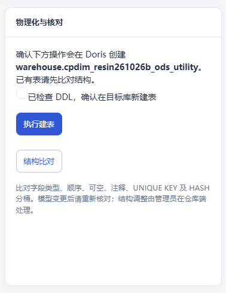

*图 09：LiteData 实际页面截图（局部）；页面 `/models/27`。*

## 10 配置 DIM 公共维度

**目的**：统一企业等公共成员编码及展示属性。

**操作**：

1. 在模型表单选择 DIM，或从列表“新增公共维度”进入。
2. 填写业务键、展示名称字段，更新策略使用 SCD1。
3. 补齐字段后保存、预览和确认建表，再在数据加工配置写入。

**示例**：既有模型 cpdim_resin261026b_dim_enterprise；业务键 enterprise_id；展示名称 enterprise_name。

**结果检查**：模型详情展示业务键和 SCD1；同一业务键再次写入会覆盖当前属性。

**操作提醒**：SCD1 不保留成员历史；业务键需与物理主键及顺序一致。配置 DIM 不会自动生成 JOIN 或加工 SQL。 图中为既有模型编辑页，未提交。

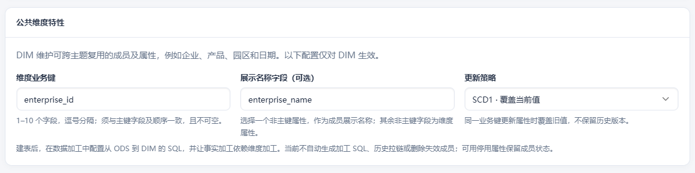

*图 10：LiteData 实际页面截图（局部）；页面 `/models/29/edit`。*

## 11 配置时间水位同步管道

**目的**：把源表增量数据接入 Doris ODS。

**操作**：

1. 进入“同步管道”，点击新增；已有任务通过“编辑”查看。
2. 选择来源数据源，填写来源表、Doris 目标表和 Watermark 列。
3. 只同步 ODS 时将“同步后加工”留空，独立加工放到数据加工模块。

**示例**：来源 cpdim_resin261026b_utility → 目标 cpdim_resin261026b_ods_utility；水位 updated_at。

**结果检查**：保存后列表显示源→目标、运行状态和最近成功水位。

**操作提醒**：目标表应先存在并支持业务键幂等写入；水位须非空、有前导索引，源系统须保证新增和修改时更新水位列，否则可能漏采。

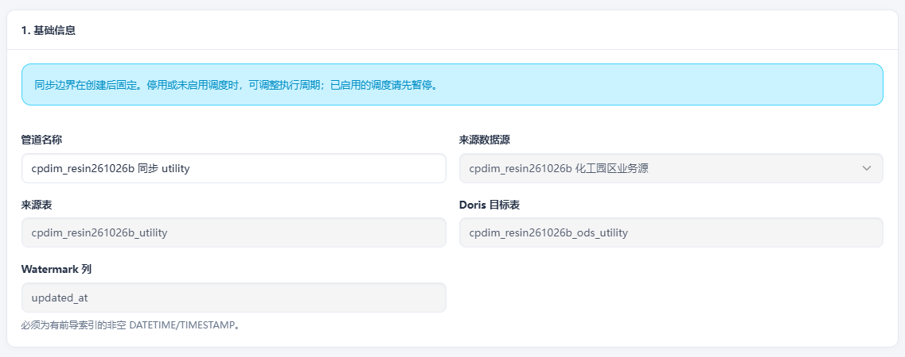

*图 11：LiteData 实际页面截图（局部）；页面 `/pipelines/15/edit`。*

## 12 设置频率并预览三次触发

**目的**：在启动调度前验证计划和时区。

**操作**：

1. 在“调度设置”选择周期或填写 Quartz Cron。
2. 阅读北京时间下三次计划触发时间。
3. 点击“保存管道”；保存配置后仍需单独启用定时。

**示例**：每 15 分钟：0 */15 * * * ?；每日 08:30：0 30 8 * * ?。

**结果检查**：预览列出三次 Asia/Shanghai 计划时间，表达式错误时应修正后再保存。

**操作提醒**：截图仅修改表单并预览，未保存。启用中的调度应先暂停，确认无运行实例后修改；预览不代表已上线。

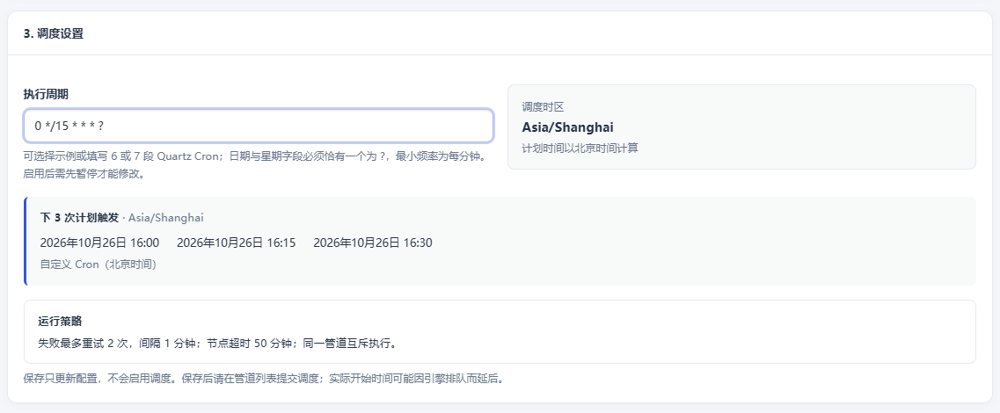

*图 12：LiteData 实际页面截图（局部）；页面 `/pipelines/15/edit`。*

## 13 手动运行并启停定时调度

**目的**：先验证一批执行，再决定是否启用周期运行。

**操作**：

1. 找到管道，点击“立即运行”。
2. 进入“实例 / 日志”确认真实工作流和节点成功。
3. 验证通过后点击“启用定时”；需要停用未来计划时点击“停用定时”。

**示例**：先手动验证“cpdim_resin261026b 同步 utility”；截图中调度为未启用。

**结果检查**：真实同步及管道内加工均成功后才推进水位；运行失败需排障后重跑。

**操作提醒**：截图展示操作入口，本次没有触发运行或启用调度。暂停不取消已提交实例，也不回退水位；时间水位不具备完整 CDC 硬删除语义。

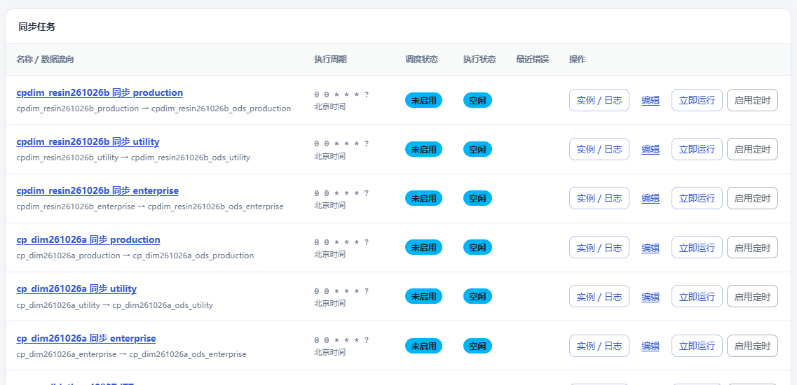

*图 13：LiteData 实际页面截图（局部）；页面 `/pipelines`。*

## 14 查询运行实例

**目的**：区分任务提交成功与实际执行成功。

**操作**：

1. 从管道行“实例 / 日志”进入。
2. 按执行链路版本、状态查询，可用“每页”分页。
3. 点击目标实例“节点 / 日志”。

**示例**：既有实例 #28 显示成功，包含开始和结束时间。

**结果检查**：找到指定批次的真实 DolphinScheduler 工作流实例。

**操作提醒**：这里的引擎实例编号与平台同步/SQL 回调记录编号独立；有提交记录仍需查看执行结果。

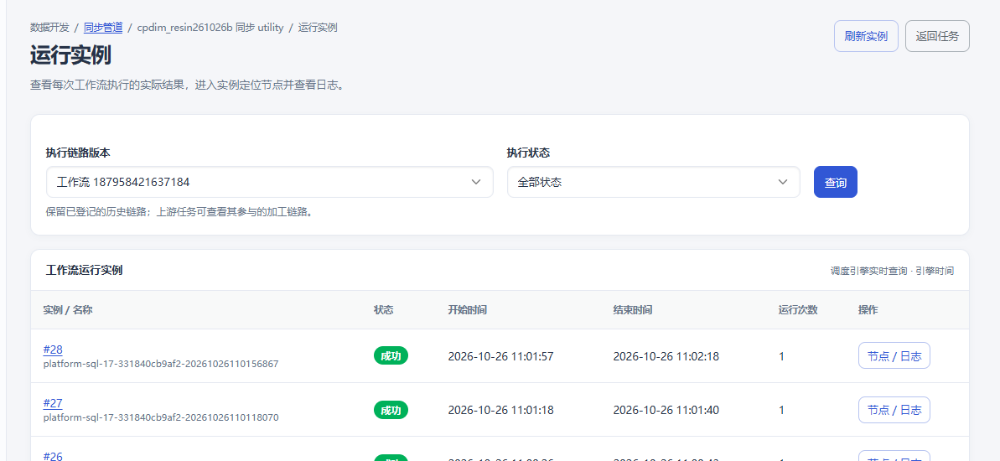

*图 14：LiteData 实际页面截图（局部）；页面 `/scheduling/pipeline/15`。*

## 15 定位节点并读取日志

**目的**：把失败定位到具体同步或 SQL 节点。

**操作**：

1. 进入实例详情，选择节点；失败节点优先查看。
2. 读取节点状态、重试次数和日志，必要时继续加载或从头读取。
3. 用日志检索定位错误；下载仅包含当前已加载并脱敏的窗口。

**示例**：既有成功实例 #28；节点列表包含同步及分层 SQL 任务。

**结果检查**：能看到节点执行状态、开始/结束时间和日志区；不可读时显示明确提示。

**操作提醒**：状态默认每 5 秒更新；日志自动追踪独立控制。平台简要消息不能替代完整引擎日志，VIEWER 不能读取节点日志。

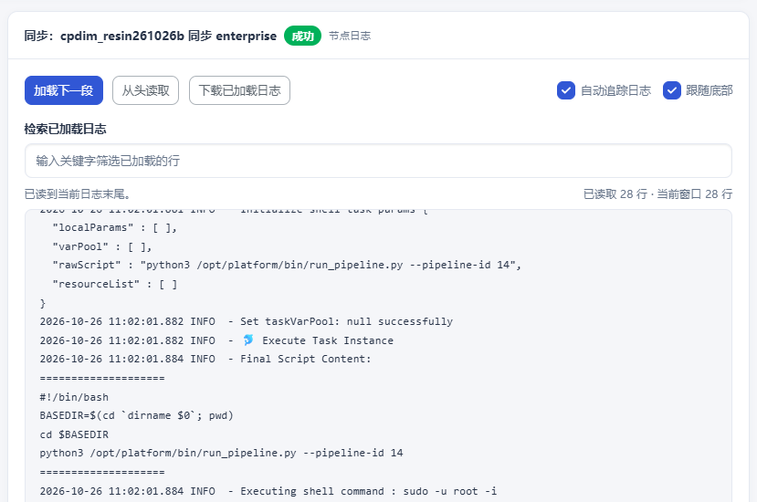

*图 15：LiteData 实际页面截图（局部）；页面 `/scheduling/pipeline/15/instances/28`。*

## 16 编写分层 INSERT SELECT

**目的**：将 ODS 数据清洗、关联或汇总写入目标层。

**操作**：

1. 先完成目标 DIM/DWD/DWS/ADS 模型建表和结构核对。
2. 新增数据加工，填写名称并选择目标模型。
3. 填写单条 INSERT INTO ... SELECT，写入表必须与所选目标模型一致。

**示例**：既有“日能耗产量明细”写入 cpdim_resin261026b_dwd_utility_day，并关联企业维度与生产数据。

**结果检查**：SQL 和目标模型匹配；保存时进行受控语法及依赖校验。

**操作提醒**：不支持多语句、任意脚本、跨库写入或读取自身目标表。一个目标模型只对应一个加工任务。

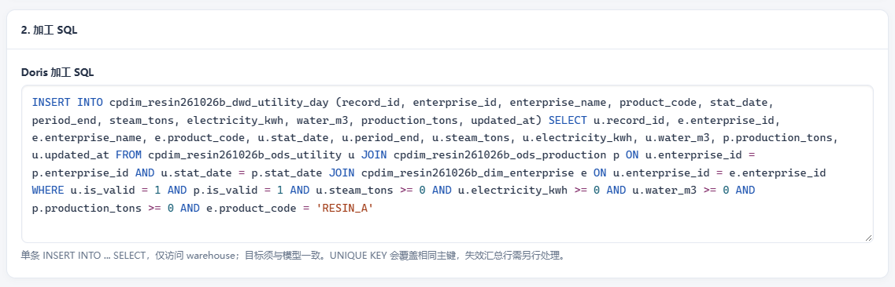

*图 16：LiteData 实际页面截图（局部）；页面 `/transforms/15/edit`。*

## 17 声明直接上游依赖

**目的**：确保当次上游成功后才运行下游。

**操作**：

1. 在“上游依赖”选择直接上游加工任务和同步管道。
2. 使用筛选框按名称或目标表定位，勾选真实依赖。
3. 保存后检查系统展开的完整依赖链，不能只依赖 SQL 文本中的表名。

**示例**：DWD 明细依赖公共企业维度加工，以及 utility / production 的 ODS 同步。

**结果检查**：依赖链包含必需上游，并拒绝循环依赖；同一条链中的共享节点执行一次。

**操作提醒**：筛选不会改变已经勾选的选项。配置人需显式声明依赖；平台不会按 SQL 自动推断并触发所有上游。

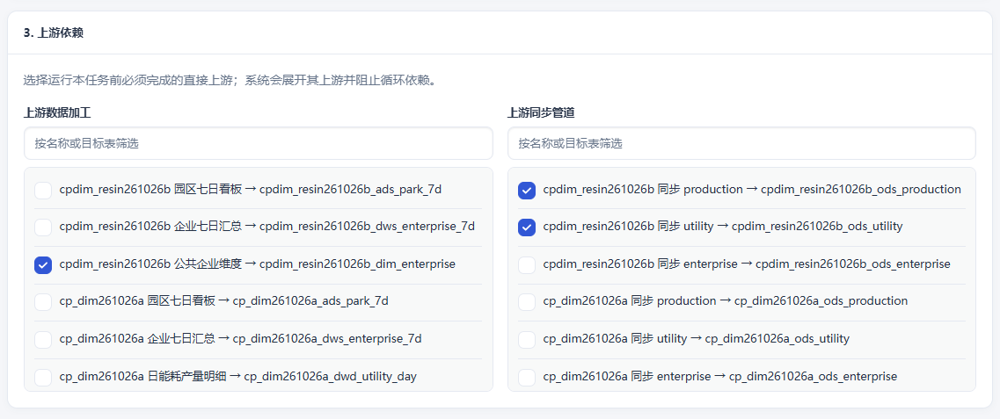

*图 17：LiteData 实际页面截图（局部）；页面 `/transforms/15/edit`。*

## 18 查看依赖链并运行整链

**目的**：验证完整链路顺序，而非只执行最后一段 SQL。

**操作**：

1. 进入末端任务“依赖 / 运行”。
2. 核对同步、DIM、DWD、DWS、ADS 的执行顺序。
3. 点击“运行整条依赖链”，通过运行实例和 SQL 记录确认全部成功。

**示例**：园区末端看板任务：cpdim_resin261026b_ads_park_7d；上游包含三条同步及四层加工。

**结果检查**：本次整链重跑全部声明上游；历史成功不能替代本次执行。

**操作提醒**：截图为既有依赖链和记录，本次未重跑。建议只在末端启用定时；独立下游 SQL 失败不会回退已成功同步的水位。

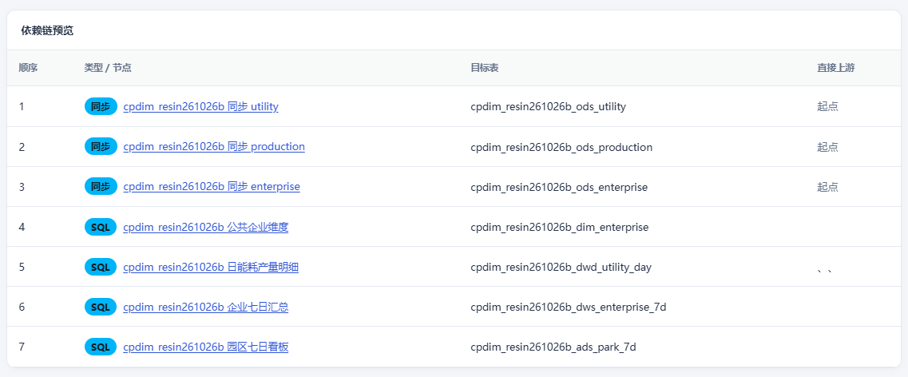

*图 18：LiteData 实际页面截图（局部）；页面 `/transforms/17`。*

## 19 创建受控查询服务

**目的**：把审核后的只读查询提供给应用使用。

**操作**：

1. 进入“数据服务”，点击新增。
2. 填写服务名称和小写服务标识，编写 SELECT 及命名参数。
3. 设置稳定 ORDER BY，点击“创建服务”。

**示例**：服务标识 manual-orders；SQL：SELECT id, customer_name, amount, updated_at FROM ads_orders WHERE id = :id ORDER BY id。

**结果检查**：服务保存后可在列表查看并执行发布操作；参数 id 由请求传入。

**操作提醒**：截图为未保存的填写示例，来源于 README 的订单链路。pageNum / pageSize 是分页保留名，不能用作 SQL 业务参数。

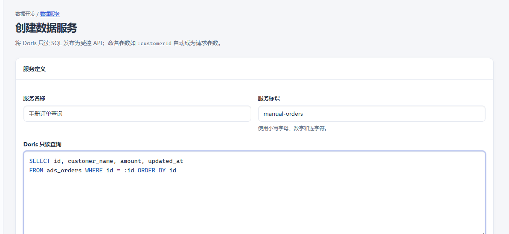

*图 19：LiteData 实际页面截图（局部）；页面 `/services/new`。*

## 20 发布服务并生成调用凭证

**目的**：为应用提供可用服务及独立认证凭证。

**操作**：

1. 找到服务，核对 SQL 后点击“发布”；停用服务使用“下线”。
2. 点击“生成密钥”，妥善保存一次性显示的凭证。
3. 使用 X-API-Key 调用 /api/data/{服务标识}。

**示例**：既有服务 cpdim-resin261026b-daily 已发布；调用时使用它自己的服务级密钥。

**结果检查**：已发布状态和有效凭证同时满足后，应用才能查询数据。

**操作提醒**：截图展示既有状态与入口，本次未发布或生成密钥。重新生成会吊销旧凭证；服务密钥、我的 API Key 和网页 Session 分别使用。

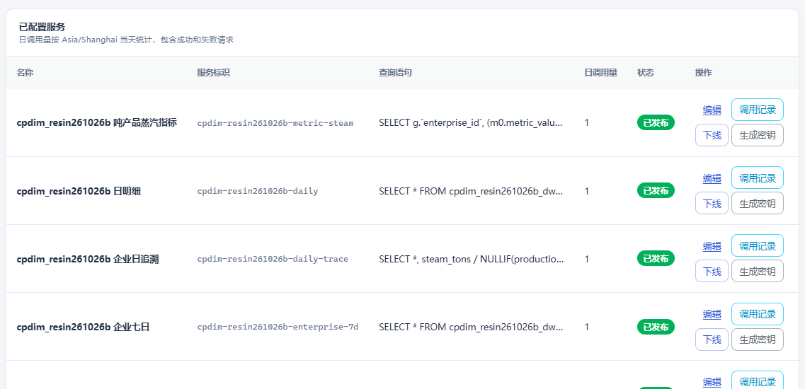

*图 20：LiteData 实际页面截图（局部）；页面 `/services`。*

## 21 调用接口并核对调用记录

**目的**：用请求和审计结果确认接口可用。

**操作**：

1. 在终端或接口客户端发送请求，携带 X-API-Key 请求头。
2. 传入业务参数与 pageNum / pageSize。
3. 返回平台点击“调用记录”，核对时间、状态、耗时、行数和分页信息。

**示例**：curl -H "X-API-Key: <服务凭证>" "http://localhost:8080/api/data/manual-orders?id=1&pageNum=1&pageSize=20"

**结果检查**：成功响应含 data、count、pageNum、pageSize、hasMore；截图为已有园区日明细服务的真实调用记录。

**操作提醒**：示例命令需先完成 manual-orders 服务创建、发布及发证，当前未创建。接口查询默认每页 100（范围 1–1000）；调用记录页面默认每页 20。接口不返回 total 或 truncated。

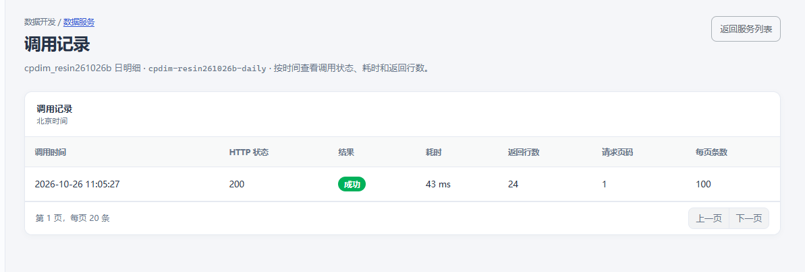

*图 21：LiteData 实际页面截图（局部）；页面 `/services/22/calls`。*

## 22 采集元数据结构

**目的**：让真实表和字段进入元数据目录。

**操作**：

1. 进入“元数据与血缘”，点击“采集元数据”。
2. 选择 Doris 数仓或已登记的业务数据源。
3. 点击“开始采集”，成功后在目录检索目标表。

**示例**：Doris 选择“Doris 数仓 · warehouse”；业务源选择已测试的园区数据源。

**结果检查**：目录出现表结构、采集时间和版本；采集失败保留上次快照。

**操作提醒**：截图展示采集入口，本次未发起新采集。每次采集一个数据库；结构内容未变化时版本不递增。

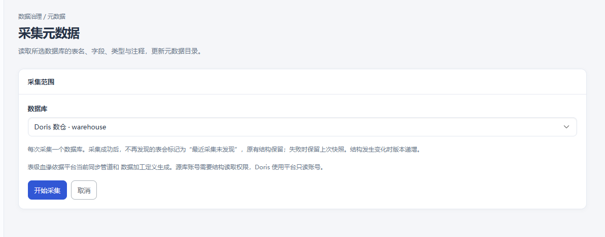

*图 22：LiteData 实际页面截图（局部）；页面 `/metadata/collect`。*

## 23 检索表并查看字段

**目的**：确认实际物理结构与业务认知一致。

**操作**：

1. 在元数据目录按表名搜索并打开表详情。
2. 核对来源、层级、版本、采集时间。
3. 查看字段名、类型、可空和注释，按需跳转关联资源。

**示例**：warehouse.cpdim_resin261026b_dwd_utility_day；包含 enterprise_id、stat_date、steam_tons 和 production_tons。

**结果检查**：能读到最近一次采集的实际字段结构。

**操作提醒**：结构是最近采集快照，改表后需重新采集；“最近采集未发现”不等于已证实删除。

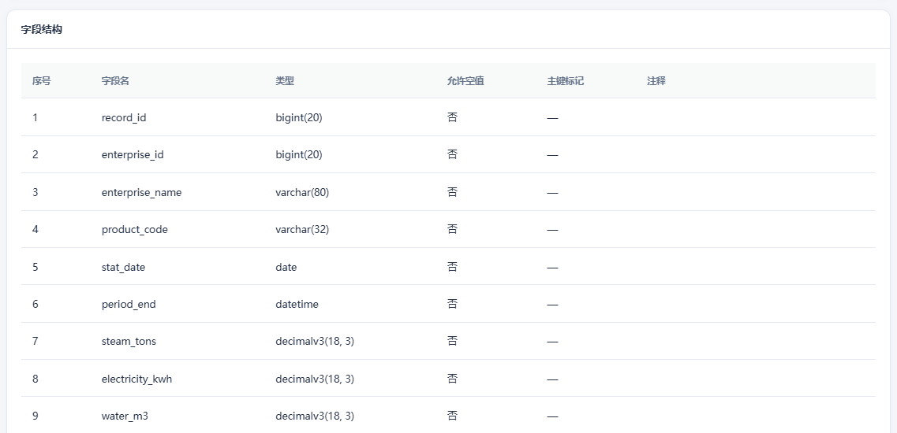

*图 23：LiteData 实际页面截图（局部）；页面 `/metadata/65`。*

## 24 追溯表级上下游

**目的**：分析数据来源和结构变更的影响范围。

**操作**：

1. 从表详情或目录点击“查看血缘”。
2. 选择上游来源、下游影响或上下游，以及展开层数，点击“应用”。
3. 拖动、缩放或适应画布；点击已采集节点查看结构。

**示例**：DWD 日能耗产量明细向上追溯 ODS 和 DIM，向下影响 DWS 与 ADS。

**结果检查**：图中箭头由读取表指向写入表；下方关系明细可跳转产生关系的任务。

**操作提醒**：表级血缘依据当前配置，包含未发布任务；它不证明任务执行成功，也不代表实际数据流量。

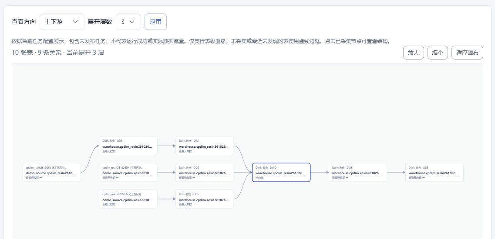

*图 24：LiteData 实际页面截图（局部）；页面 `/metadata/65/lineage`。*

## 25 通过资产目录发现数据

**目的**：用统一入口查找表、模型、指标和服务。

**操作**：

1. 进入“资产目录”。
2. 按关键词、类型、主题域、状态、负责人或标签筛选。
3. 点击资产名称进入详情，按需打开结构、血缘、质量或服务入口。

**示例**：关键词可用 cpdim_resin261026b；业务分析人员可优先筛选“指标”或“数据服务”。

**结果检查**：结果同时展示来源类型、业务说明和可用状态，并支持数据库分页。

**操作提醒**：目录状态只反映原资源的当前状态，目录标签不会授予访问权限。

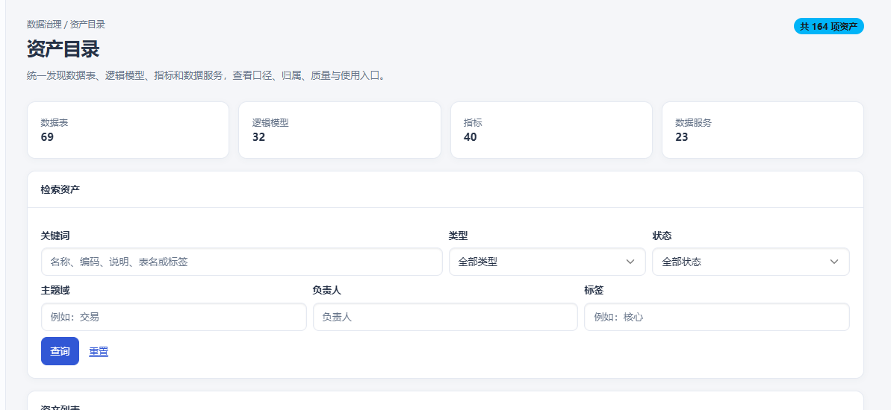

*图 25：LiteData 实际页面截图（局部）；页面 `/assets`。*

## 26 维护资产业务说明

**目的**：让使用者快速理解数据含义及责任归属。

**操作**：

1. 在资产详情点击编辑目录信息。
2. 补充业务名称、负责人、标签、更新频率、敏感级别和业务说明。
3. 点击“保存目录信息”。

**示例**：负责人 数据开发；标签 核心,能耗分析；业务说明记录企业日能耗及产量用途。

**结果检查**：资产详情展示维护后的治理信息，便于搜索和沟通。

**操作提醒**：截图为未提交的编辑示例。目录编辑不修改原始模型、指标或服务定义，也不改变数据授权。

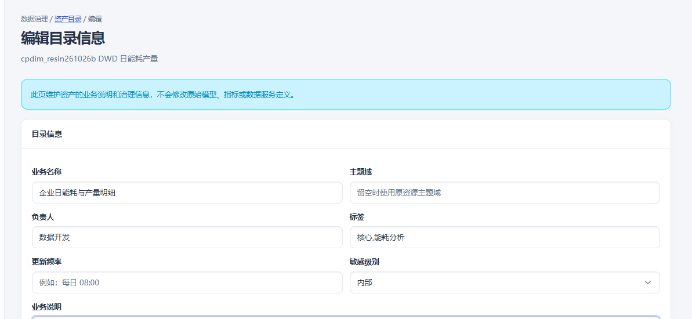

*图 26：LiteData 实际页面截图（局部）；页面 `/assets/MODEL/30/edit`。*

## 27 创建质量扫描任务

**目的**：定义需要检查的物理表和执行范围。

**操作**：

1. 进入“数据质量”，新增任务。
2. 选择 Doris 数仓或已登记的 MySQL 源，填写连接库中的单表名和负责人。
3. 首次将 Cron 留空；全表检查时将时间字段留空。

**示例**：表名 cpdim_resin261026b_dwd_utility_day；超时 30 秒；首次手动运行。

**结果检查**：任务对象和范围清楚，继续配置规则后保存。

**操作提醒**：截图为未保存表单。时间字段为空表示全表；填写时使用 [扫描开始 - 窗口小时数, 扫描开始) 范围。其他源库类型暂不支持质量扫描。

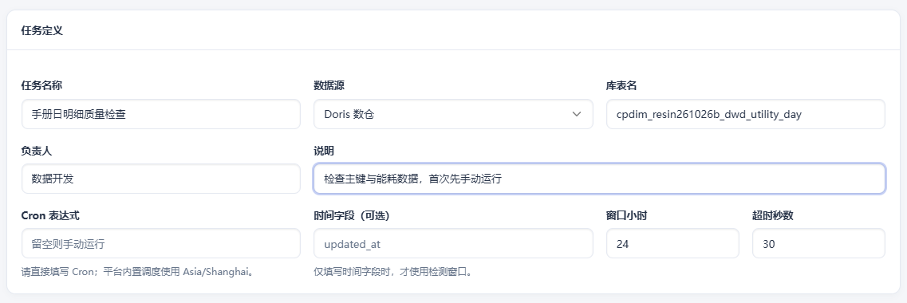

*图 27：LiteData 实际页面截图（局部）；页面 `/quality/new`。*

## 28 配置规则和容忍阈值

**目的**：把质量要求转成可执行的异常判断。

**操作**：

1. 在扫描规则区填写规则名称、类型和字段。
2. 设置严重级别、容忍异常数及异常比例。
3. 按需要添加唯一性、非负数、引用完整性和数据量规则，点击“保存质量任务”。

**示例**：非空：enterprise_id,stat_date；严重；异常数 0、异常比例 0%。另加联合唯一：enterprise_id,stat_date。

**结果检查**：任务保存后详情显示规则集合及配置版本。

**操作提醒**：异常数与异常比例必须都不超限才通过。空表的字段规则可能通过，建议搭配数据量范围；最多 30 条规则。

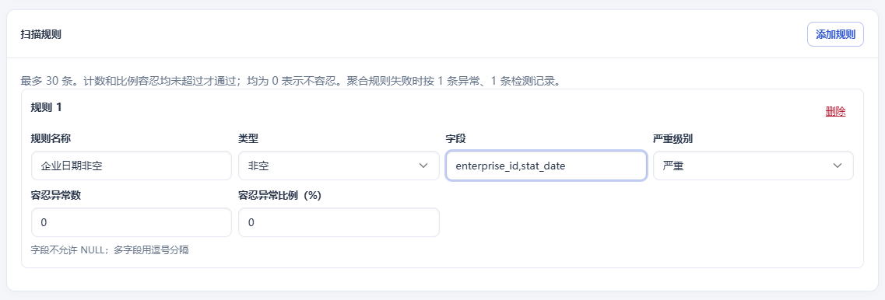

*图 28：LiteData 实际页面截图（局部）；页面 `/quality/new`。*

## 29 运行扫描并逐条检查结果

**目的**：区分数据异常与执行失败。

**操作**：

1. 从任务详情点击“立即运行”。
2. 进入运行详情；运行中时刷新查看进展。
3. 逐条核对检查数、异常数、异常比例和规则消息。

**示例**：既有园区日明细运行 #20 显示通过，规则包括引用完整性、非负和联合唯一。

**结果检查**：PASSED 为规则通过；WARNING 为警告或波动首批基线；FAILED 为严重数据异常；ERROR 为扫描未完成。

**操作提醒**：截图为已有结果，本次未重新运行。质量扫描只读，不自动修复数据或推进同步水位。

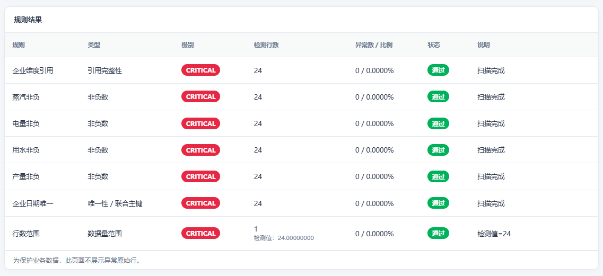

*图 29：LiteData 实际页面截图（局部）；页面 `/quality/runs/20`。*

## 30 为质量任务启用定时

**目的**：在数据写入结束后自动进行检查。

**操作**：

1. 编辑任务，填写六段 Spring Cron，保存。
2. 确认规则与时间窗口后在任务详情启用定时。
3. 需调整配置时暂停并编辑；保存新版本后重新确认启用。

**示例**：每日 02:00：0 0 2 * * *，时区 Asia/Shanghai。

**结果检查**：详情显示已启用；后续运行历史保留当时规则快照。

**操作提醒**：截图仅填写、未保存或启用。质量调度由平台进程执行，Cron 与同步/加工的 Quartz 格式不同；平台离线不逐批补跑。

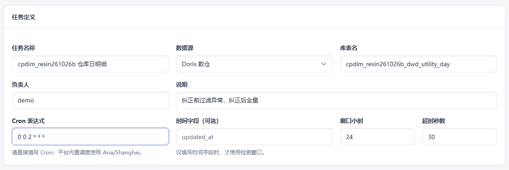

*图 30：LiteData 实际页面截图（局部）；页面 `/quality/10/edit`。*

## 31 定义原子指标

**目的**：统一基础聚合的模型、维度、度量和口径。

**操作**：

1. 进入“指标管理”，新增并选择“原子指标”。
2. 填写编码、名称、主题域、负责人、单位和口径说明。
3. 选择来源模型、聚合方式、度量字段、维度和可选时间字段，点击保存。

**示例**：manual_electricity；SUM(electricity_kwh)；维度 enterprise_id；时间 stat_date；单位 kWh。

**结果检查**：保存生成带 metric_value 的 SELECT 和不可变版本快照。

**操作提醒**：截图为未保存示例；来源模型为 cpdim_resin261026b_dwd_utility_day。编码和类型首次保存后固定，定义指标不会执行查询。

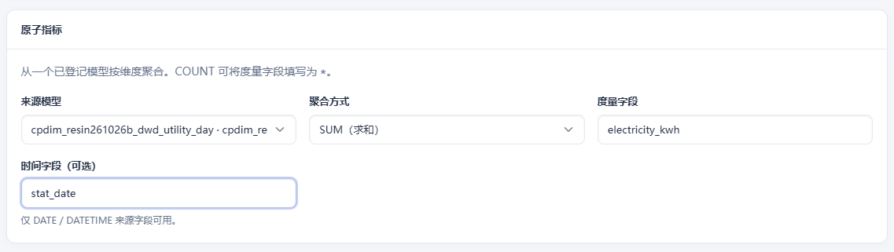

*图 31：LiteData 实际页面截图（局部）；页面 `/metrics/new`。*

## 32 从原子指标派生七日指标

**目的**：以明确时间窗口和筛选条件约束基础指标。

**操作**：

1. 新增时选择“派生指标”。
2. 选择原子指标，填写窗口天数和可选业务筛选。
3. 核对继承的模型、度量和维度后保存。

**示例**：既有 cpdim_resin261026b_electricity_7d：引用 electricity_daily，窗口 7 天。 业务筛选：product_code = 'RESIN_A'。

**结果检查**：生成以数据库当前时间为终点的七日滚动区间查询。

**操作提醒**：窗口是滚动 [当前时间 - 7 天, 当前时间)，不是自然周；不含未来时间。维度继承自原子指标。

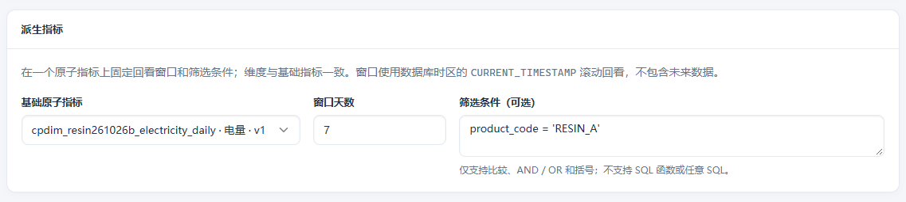

*图 32：LiteData 实际页面截图（局部）；页面 `/metrics/34/edit`。*

## 33 组合单位产品能耗指标

**目的**：用一致的输入口径计算业务比率。

**操作**：

1. 新增时选择“复合指标”。
2. 用 [指标编码] 引用已有指标，填写四则运算公式。
3. 核对输入维度、时间范围、单位、过滤条件和去重方式后保存。

**示例**：[cpdim_resin261026b_steam_7d] / [cpdim_resin261026b_production_7d] → 七日吨产品蒸汽。

**结果检查**：保存后固定引用的上游指标版本，除零通过 NULLIF 返回 NULL。

**操作提醒**：同名维度不保证口径兼容；缺失输入保留 NULL，不会自动补零。截图为既有定义的编辑页，未保存。

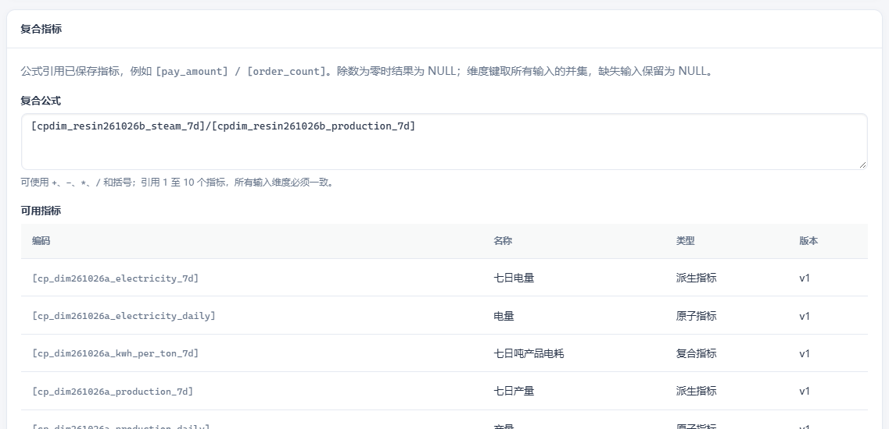

*图 33：LiteData 实际页面截图（局部）；页面 `/metrics/39/edit`。*

## 34 查看 SQL 与版本历史

**目的**：让指标定义可复核、可追溯。

**操作**：

1. 在指标列表点击“查看”。
2. 阅读定义、SQL 预览、依赖快照及下游引用。
3. 在版本历史打开指定版本，核对修改人和当时口径。

**示例**：七日吨产品蒸汽 v1，SQL 引用已保存的蒸汽和产量指标版本。

**结果检查**：当前和历史版本都能查看冻结的 SQL 与依赖证据。

**操作提醒**：上游修改不会自动更新已保存下游；需逐级重新保存。指标模块不自动计算、落表或发布 API；使用 SQL 时另建加工或服务。

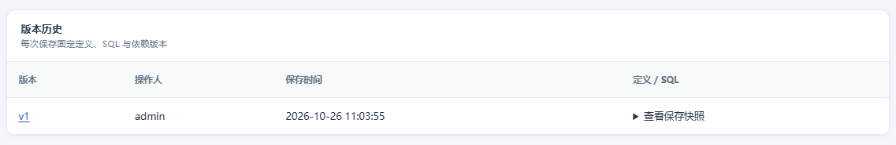

*图 34：LiteData 实际页面截图（局部）；页面 `/metrics/39`。*

## 35 追溯指标字段血缘

**目的**：把指标值追溯到聚合、仓库字段与业务来源。

**操作**：

1. 在指标详情点击“血缘查看”。
2. 选择 metric_value 或统计维度，选择直接来源或完整依赖并应用。
3. 点击节点聚焦全部上游；拖动、缩放或定位指标，查看下方影响条件。

**示例**：七日吨产品蒸汽 → 七日蒸汽 / 七日产量 → DWD → ODS → 业务源字段。

**结果检查**：精简图显示所选输出的取值和计算关系，完整依赖包含关联、筛选及窗口条件。

**操作提醒**：图是指标版本冻结的配置证据，不能证明运行正确。旧版本没有完整历史证据时会显示边界提示。

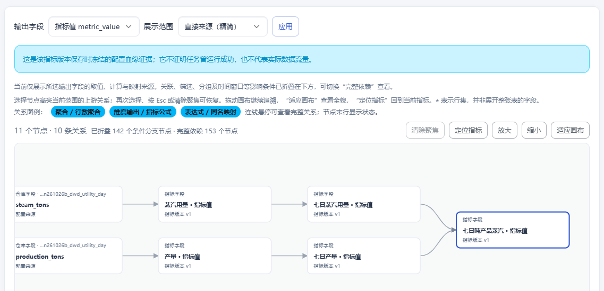

*图 35：LiteData 实际页面截图（局部）；页面 `/metrics/39/lineage`。*

## 36 创建账号并选择角色

**目的**：为不同职责分配合适的管理权限。

**操作**：

1. 管理员进入“账号权限”，点击“新增账号”。
2. 填写以字母开头的用户名，选择只读用户、开发者或管理员。
3. 设置符合要求的初始密码并保存；修改角色或密码后通知用户重新登录。

**示例**：用户名 manual_viewer；角色 只读用户（VIEWER）；初始密码由管理员另行设置。

**结果检查**：账号列表出现新用户；ADMIN 管理账号，DEVELOPER 维护数据任务，VIEWER 以查看为主。

**操作提醒**：截图为未提交表单，密码区域已遮蔽。密码至少 12 字符且不超过 72 字节；网页权限和密码下次登录生效。

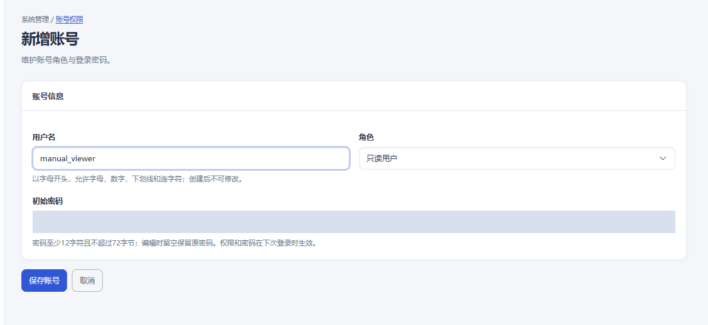

*图 36：LiteData 实际页面截图（局部）；页面 `/users/new`。*

## 37 为 Agent 创建受限 API Key

**目的**：让 Agent 只访问指定工具和数据服务。

**操作**：

1. 进入“我的 API Key”，点击创建。
2. 填写用途、有效期，勾选工具权限并填写服务白名单。
3. 点击“创建并显示 Key”，将只显示一次的 Key 保存到客户端密钥配置。

**示例**：名称 手册只读分析 Agent；7 天；保留列举/查询数据服务；白名单 cpdim-resin261026b-daily；不授予执行管道。

**结果检查**：Key 仅能使用角色、scope、白名单三者交集内的权限。

**操作提醒**：截图为未提交示例，未生成真实密钥。此 Key 使用 Authorization: Bearer 接入 /mcp，不是 X-API-Key 的服务密钥。

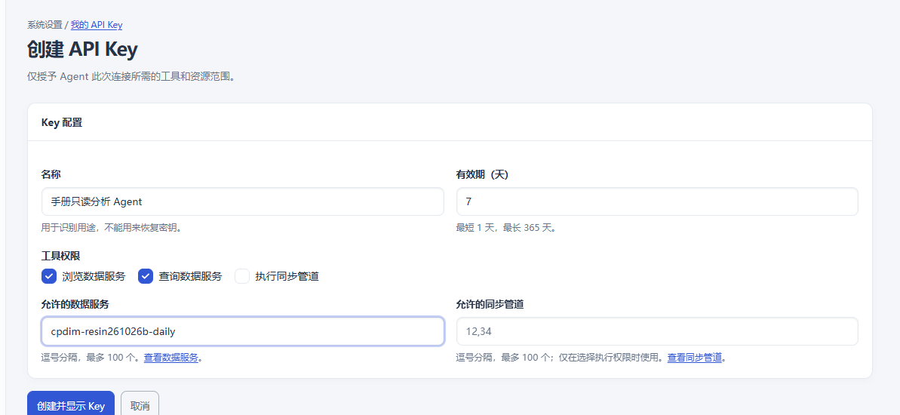

*图 37：LiteData 实际页面截图（局部）；页面 `/settings/api-keys/new`。*

## 38 检查有效期并吊销旧 Key

**目的**：在凭证轮换或泄露时及时终止后续访问。

**操作**：

1. 在“我的 API Key”查看名称、范围、有效期和最近使用时间。
2. 轮换时先创建替代 Key，更新客户端配置。
3. 确认新 Key 可用后吊销旧 Key；泄露时先立即吊销。

**示例**：每个 Agent 单独命名 Key，按实际用途配置 1–365 天有效期。

**结果检查**：吊销、到期、账号停用或角色变更将在后续 MCP 请求重新校验。

**操作提醒**：截图为尚未创建 Key 的空列表；创建后在“操作”列执行吊销。时间以 UTC 显示。吊销不会追溯取消已经开始的查询或调度实例。

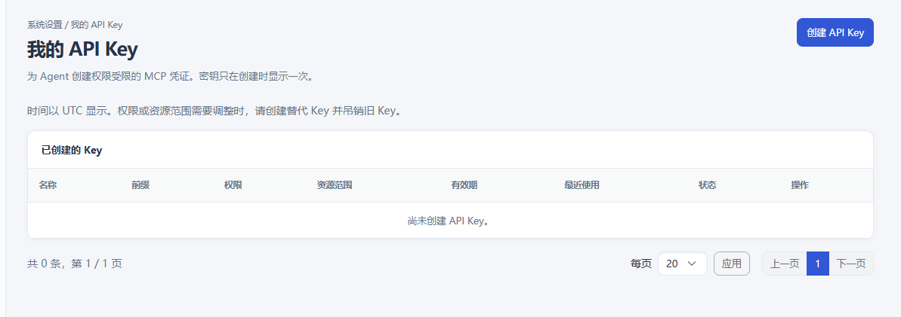

*图 38：LiteData 实际页面截图（局部）；页面 `/settings/api-keys`。*

## 39 退出登录

**目的**：结束当前网页会话，减少共享电脑上的误操作。

**操作**：

1. 保存正在编辑的内容。
2. 点击右上角“退出登录”图标。
3. 确认返回登录页后关闭浏览器。

**示例**：离开公共电脑前主动退出，不仅仅关闭某个业务页签。

**结果检查**：当前 Session 结束，再访问管理页面需要重新登录。

**操作提醒**：截图展示右上退出入口；它不会停止正在运行的同步、加工或质量任务。

*图 39：LiteData 实际页面截图（局部）；页面 `/`。*

## 常见问题

- 保存模型不会自动写入数据；先建表，再配置同步或加工。
- 任务提交不代表执行成功，应查看真实实例及节点。
- 停用未来调度不取消已提交实例，不回退水位。
- 质量 Cron 使用 Spring 六段格式；同步/SQL 使用 Quartz，时区均需核对。
- 质量 ERROR 不表示数据通过，空表需按需增加数据量规则。
- 服务编辑后恢复草稿；重新发证吊销旧凭证。
- 指标保存固定 SQL 与依赖版本，上游改变不会自动更新下游。
- 资产标签不授予权限；血缘是配置证据，不证明执行结果。

## 资料索引

- [README.md](../README.md)：能力范围、启动、订单演示与 API 边界
- [docs/ui-guide.md](ui-guide.md)：布局、主题与外观
- [docs/data-sources.md](data-sources.md)：源类型及水位约束
- [docs/modeling.md](modeling.md)：建模、DDL、结构核对
- [docs/dimension-models.md](dimension-models.md)：DIM 与 SCD1 语义
- [docs/sql-transforms.md](sql-transforms.md)：依赖链、整链运行、版本及互斥
- [docs/scheduling-operations.md](scheduling-operations.md)：Cron、实例和脱敏日志
- [docs/metadata-lineage.md](metadata-lineage.md)：结构采集、表级血缘
- [docs/asset-directory.md](asset-directory.md)：资产检索与治理描述
- [docs/data-quality.md](data-quality.md)：18 类质量规则与结果
- [docs/metrics.md](metrics.md)：三类指标、版本与字段血缘
- [docs/mcp.md](mcp.md)：用户 Key、scope 与资源白名单
- [examples/chemical-park-dim/README.md](../examples/chemical-park-dim/README.md)：园区 DIM 完整示例及合成数据
- [src/main/resources/templates/](../src/main/resources/templates/)：实际按钮、表单、页面与路由
