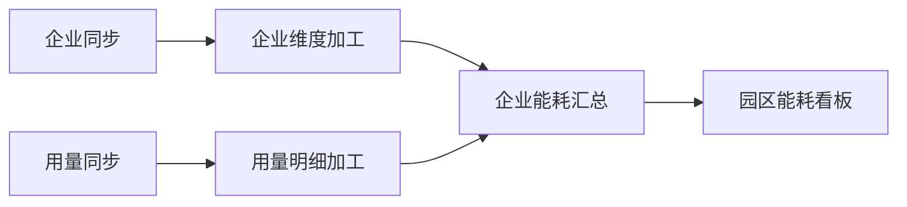

# 工作流画布使用说明

适用版本：LiteData `0.1.0-SNAPSHOT`，维护日期：2026-10-31。

本文面向开发和运维人员，说明如何在一张画布中组织同步管道与 SQL 加工任务，设置执行计划，以及查看整条链路的运行结果。按钮名称以当前界面为准。

## 1. 先了解工作流如何执行

一个工作流由**一个末端 SQL 加工任务和它的全部上游**组成。末端任务代表最终产出，例如“园区日报”；上游可以是同步管道，也可以是其他加工任务。

**执行周期决定何时启动整条链，上游依赖决定链内的执行顺序。**

- 手动点击“运行”，或定时计划到达后，系统执行本次工作流所声明的全部上游。
- 一个加工任务需要等待它在本次执行中依赖的上游全部成功，才会开始；相互独立的分支可由引擎并行执行。
- 同一条工作流内，共享上游只执行一次。不同工作流分别运行时，仍可能重复执行同一个共享任务。
- 上游过去的成功记录不会替代本次执行；上游单独运行成功，也不会自动触发这个工作流。
- 平台不会根据 SQL 中出现的表名自动补齐所有调度依赖，实际需要的上游必须在画布中声明。

例如：选择“每小时整点”，16:00 启动工作流，上游在 16:08 全部成功，当前加工任务随后即可执行，无需等到 17:00。资源排队或运行互斥仍可能延后实际开始时间。

## 2. 操作前的准备

1. 使用具备操作权限的账号登录。
2. 在“数据建模”准备并建好加工目标模型，完成结构核对。
3. 在“数据加工”创建末端任务，填写名称、目标模型和加工 SQL。
4. 需要刷新 ODS 时，准备相应的“同步管道”；还没有准备好的其他上游任务，也可以稍后从画布进入独立页面创建。
5. 首次运行前，确认管理员已配置好 DolphinScheduler、执行器及 Doris 连接。

| 账号角色 | 可进行的操作 |
| --- | --- |
| ADMIN / DEVELOPER | 创建和编辑工作流、编排依赖、运行和启停定时、查看状态与节点日志 |
| VIEWER | 查看工作流、依赖图和运行状态；不能修改、提交运行或读取节点日志 |

SQL 任务及目标模型的具体要求见[数据加工说明](sql-transforms.md#执行版本与并发)；ODS 接入见[数据源说明](data-sources.md)。

## 3. 打开或创建工作流

### 3.1 打开已有工作流

1. 点击左侧菜单“工作流”。
2. 用“搜索”按工作流名称、说明或末端任务名称筛选；可通过列表下方的分页控件翻页。
3. 点击工作流名称或“画布”进入编排页面；点击“实例”进入运行记录。

如果已有对应工作流，直接打开即可，无需重复新建。

### 3.2 新建工作流

1. 在工作流列表点击“新建工作流”。
2. 填写下表内容。
3. 点击“创建并编辑画布”。

| 字段 | 填写方式 |
| --- | --- |
| 工作流名称 | 必填，名称唯一，最多 100 字符。建议使用业务名称，例如“园区每日能耗看板” |
| 末端任务 | 必选，选择最终产出的 SQL 加工任务。已有工作流占用的末端任务不会再次列出 |
| 说明 | 可选，最多 500 字符，说明业务用途或处理范围 |

创建后，末端任务不能更换。需要采用另一个末端任务时，应新建工作流；名称与说明可通过画布右上角“编辑信息”修改。

## 4. 认识画布页面

| 区域 | 用途 |
| --- | --- |
| 顶部信息区 | 查看工作流名称、末端任务及调度信息；进入“编辑信息”或“运行实例” |
| 集中运行与调度 | 手动“运行”、填写“Cron 周期（北京时间）”、“启用定时”或“暂停” |
| 左侧“添加任务” | 搜索已有任务、翻页选择任务，或进入独立页面新增任务；也可用下拉框连线 |
| 中间依赖画布 | 查看节点、上下游连线，选择节点、移动位置及进入任务编辑页 |
| 画布工具栏 | “自动布局”“放大”“缩小”“适应画布”“删除选中” |
| 底部操作区 | “保存画布”“返回工作流”；保存结果或错误提示会在页面显示 |

在小屏设备上，添加任务区域会排列到画布下方。画布内部可滚动；需要查看完整链路时可使用“适应画布”。

## 5. 添加任务并建立依赖

### 5.1 从目录添加已有任务

1. 先在画布中选中接收该上游产出的**下游 SQL 节点**。
2. 在“搜索目录”输入任务名称或目标表名，必要时点击“上一页”“下一页”。
3. 点击需要添加的目录项。
4. 检查系统加入的节点和连线。

添加时，系统会带入该任务已有的上游，并自动连接到当前选中的 SQL 节点；没有选中 SQL 节点时，默认连接到末端任务。已有节点会被复用，不会在同一张图中重复创建。

例如要让“企业汇总”依赖“用量明细”，应先选中“企业汇总”，再从目录添加“用量明细”。

### 5.2 创建尚不存在的任务

1. 先保存当前画布。
2. 在“添加任务”区域点击“新增加工任务”或“新增同步管道”。
3. 在独立页面完成配置并保存，返回工作流画布。
4. 搜索新任务，再按上一节的方式将它加入画布。

**创建任务不会自动把它加入当前工作流。** 创建和加入画布是两个步骤。

### 5.3 使用端口连线

1. 点击上游节点右侧的圆形端口。
2. 点击下游 SQL 节点左侧的圆形端口，建立“上游 → 下游”的依赖。
3. 检查连线方向和目标节点。

当前端口采用依次点击的操作方式。拖动节点用于调整位置，不会因此创建依赖。

### 5.4 使用下拉框连线

1. 在左侧“上游节点”选择先执行的任务。
2. 在“下游加工任务”选择等待它的 SQL 任务。
3. 点击“添加连线”。

这种方式适合节点较密集、触屏或键盘操作的场景。

### 5.5 检查图是否完整

- 单个工作流包含 1–100 个节点。
- 必须保留末端任务，所有节点都要直接或间接通向它。
- 同步管道只能作为上游，不能接收其他节点作为自己的上游。
- 末端任务不能继续作为图中其他任务的上游。
- 不允许自身依赖、循环依赖或重复连线。

图中连线表示执行先后关系。仅在画布上摆放两个相邻节点，不会建立依赖。

## 6. 移动、移出和编辑节点

### 6.1 调整布局

拖动节点可改变位置；点击“自动布局”可按依赖关系重新排列。调整布局后点击“保存画布”，使布局在后续打开时仍可使用。放大、缩小和适应画布仅改变查看比例。

仅保存布局不会改变 SQL 任务版本，也不会使已经发布的调度失效。

### 6.2 删除连线或移出节点

1. 点击需要删除的连线或移出的节点。
2. 点击“删除选中”。
3. 核对剩余依赖，再点击“保存画布”。

移出节点会去掉它与图中下游的连接；如果其他上游因此不再通向末端，也会被自动移出画布。**任务本身、目标表和历史记录都会保留。** 末端任务不能移出。

移出依赖不会同步改写 SQL。如果 SQL 仍读取该上游目标表，需要确认数据刷新方式，避免读取旧数据。

### 6.3 在独立页面编辑任务

1. 保存画布中的未保存变更。
2. 点击节点内的“编辑任务”。
3. 在独立页面修改任务配置。
4. 保存后返回工作流；点击“取消”也会返回。
5. 重新核对画布，尤其是修改 SQL 输入表之后的上游依赖。

SQL 任务编辑页负责名称、目标模型和 SQL，依赖及工作流周期在画布中维护。浏览器会尽力保留本次会话的节点位置与选择状态，这不能替代“保存画布”。

## 7. 保存画布与处理共享任务

依赖、周期和位置发生修改后，点击“保存画布”。系统校验整张图后统一保存；校验失败时，根据页面提示调整后重试。

**共享任务的依赖是全局配置。** 同一个任务被多个工作流引用时，修改它的上游会影响其他引用它的工作流；画布中的任务不是一份相互隔离的副本。

修改 SQL、依赖或执行周期时，推荐按以下顺序操作：

1. 确认受影响的工作流，暂停相关已启用的定时调度。
2. 等待相关任务和链路结束运行。
3. 修改任务或依赖并保存，重新核对受影响的图。
4. 手动验证执行结果后，再启用需要的定时计划。

保存提示配置已变化时，说明任务、模型或工作流版本与当前页面不一致。先记录未保存的调整，再刷新页面，基于最新配置重新编排。

| 当前情况 | 页面行为 |
| --- | --- |
| 画布有未保存变更 | 阻止“运行”“启用定时”和节点内“编辑任务”；应先保存 |
| 需要暂停已启用定时 | 可直接“暂停”，不要求先保存当前草稿 |
| 保存失败 | 当前页面保留草稿，便于修正；刷新或离开页面前应记录未保存的依赖调整 |

依赖和周期没有自动保存功能。刷新页面会重新加载服务端已保存的图，**未保存的依赖和周期调整会丢失**；浏览器暂存的节点位置不能恢复这些调整。

## 8. 手动运行与定时调度

### 8.1 先手动验证

1. 保存画布，核对完整依赖图。
2. 点击“运行”。
3. 点击右上角“运行实例”，找到本次实例并查看结果。

“已提交”表示调度引擎接受了请求，最终是否成功要以运行实例和节点结果为准。手动运行不会自动启用未来的周期计划。

### 8.2 设置执行周期

在“Cron 周期（北京时间）”中填写完整的 Quartz Cron 表达式，字段顺序为：

```text
秒 分 时 日 月 周 [年]
```

支持 6 段或带年份的 7 段格式；秒字段固定为 `0`，最小调度粒度为分钟；“日”和“周”字段必须恰有一个使用 `?`。表达式必须存在未来的触发时间。

以下是填写示例，页面统一使用 Cron 输入，不再提供预设周期选择：

| Cron 表达式 | 计划时间 |
| --- | --- |
| `0 */15 * * * ?` | 每小时的 00、15、30、45 分 |
| `0 0 */3 * * ?` | 每 3 小时整点 |
| `0 30 8 * * ?` | 每天北京时间 08:30 |
| `0 0 9 ? * MON-FRI` | 每周一至周五北京时间 09:00 |
| `0 0 2 L * ?` | 每月最后一天北京时间 02:00 |

1. 输入表达式，查看“下 3 次计划触发”；输入为空或格式错误时，修正提示的问题。
2. 点击“保存画布”。
3. 需要自动运行时，再点击“启用定时”。

已有周期对应的 Cron 可以继续使用和编辑。预览采用 `Asia/Shanghai` 时区，最多显示 3 次未来触发；日期或年份受限时，按实际剩余次数显示。预览只代表计划触发时间，不代表各节点实际开始时间；空白会在保存时规范化。修改已启用的计划前，先暂停相关调度并等待运行结束。

### 8.3 暂停与恢复

点击“暂停”可停用未来的定时计划；已提交或正在运行的实例继续执行。修改完成后，点击“启用定时”恢复计划。

建议由工作流统一安排依赖链，检查共享上游是否还存在其他独立定时，避免重复刷新。

## 9. 查看运行图与节点日志

1. 从工作流列表点击“实例”，或从画布点击“运行实例”。
2. 选择执行链路版本，按状态筛选并定位本次实例。
3. 打开实例，查看整体状态、节点状态、开始和结束时间。
4. 有“工作流运行图”时，点击已派发节点，查看对应节点的日志。
5. 对失败节点检查错误信息及重试情况；也可通过下方执行节点列表切换节点。

| 看到的情况 | 如何理解与处理 |
| --- | --- |
| 等待派发 | 引擎尚未派发该节点，可能在等待上游或资源 |
| 未执行 | 工作流已结束，但该节点没有派发；先检查上游是否失败 |
| 整体或节点运行中 | 继续观察状态；一次节点失败不一定代表引擎已经结束重试 |
| 成功 | 再按业务口径核对目标数据，不能只凭提交成功判断产出 |
| 失败 | 定位失败节点并检查日志，修复后重新运行；上游失败会阻断依赖它的下游 |
| 看不到运行图 | 旧定义可能没有图快照，仍可使用实际执行节点列表和日志排查 |

运行图只读，展示该次定义保存的拓扑；修改依赖应返回编排画布。旧定义缺少快照时，不会使用当前画布补画历史。

日志页面支持状态刷新、继续加载、从头读取及检索已加载内容。日志权限、分页和自动更新的具体规则统一见[调度运维说明](scheduling-operations.md#运行实例与节点日志)。

## 10. 示例：搭建园区能耗看板工作流

以下名称均为说明用示例，不需要与实际环境完全一致。



1. 准备“企业同步”“用量同步”两个同步管道，以及“企业维度加工”“用量明细加工”“企业能耗汇总”“园区能耗看板”四个 SQL 任务。
2. 新建“园区每日能耗看板”工作流，末端任务选择“园区能耗看板”。
3. 从目录添加“企业能耗汇总”，连接到末端任务。
4. 选中“企业能耗汇总”，依次添加“企业维度加工”和“用量明细加工”。
5. 选中“企业维度加工”，添加“企业同步”；选中“用量明细加工”，添加“用量同步”。
6. 如果部分依赖已自动展开，直接核对上图的 5 条直接依赖，不要重复连线。
7. 点击“自动布局”，在“Cron 周期（北京时间）”填写 `0 0 2 * * ?`，再点击“保存画布”。
8. 点击“运行”，到实例页面确认 6 个节点均成功，再核对看板目标数据。
9. 结果符合预期后，返回画布点击“启用定时”。

该例中两条同步及其各自加工可在依赖就绪后并行推进；“企业能耗汇总”需要等待两个加工上游全部成功。

## 11. 常见问题

| 问题或提示 | 建议操作 |
| --- | --- |
| “末端任务”选项中找不到任务 | 确认它是未归档的 SQL 加工任务；若已被另一个工作流作为末端使用，请打开现有工作流 |
| 新增任务后画布上没有节点 | 返回“搜索目录”，找到任务并点击加入；新建任务不等于加入工作流 |
| 提示不能反向添加或存在循环 | 检查上下游方向，不能把末端接回上游；先移除错误连线再调整 |
| 提示所有节点必须连接到末端 | 检查是否缺少连线，或移出不属于该链路的节点 |
| 提示任务被已启用调度的链路引用 | 暂停提示中指出的相关链路，等待运行结束后再修改 |
| 提示工作流或任务配置已变化 | 记录当前调整，刷新并重新读取最新配置，避免覆盖他人的修改 |
| 提示任务正在运行或已有运行实例 | 等待本次执行结束，到实例页面确认实际状态后再操作 |
| 周期已保存，却没有自动执行 | 检查是否点击“启用定时”；保存、手动运行、启用定时是不同操作 |
| 周期未到，上游刚运行成功也没有触发 | 该工作流仍按自身的手动或定时入口触发，不监听上游独立运行的成功事件 |
| 暂停后仍看到任务执行 | 检查是否为暂停前已提交的实例，或由其他独立计划提交的实例 |
| 上游成功、下游失败后如何重跑 | 修复后从工作流重新“运行”；会再次执行声明的上游，同步水位与 SQL 重算规则见[数据加工说明](sql-transforms.md#执行版本与并发) |
| 引擎或日志暂不可用 | 保留当前实例信息，检查服务连接或联系管理员；状态未知时的处理见[中断恢复](sql-transforms.md#中断恢复) |

当前页面不提供单节点运行、从失败节点续跑、多末端出口或等待外部任务指定周期成功的配置入口。不要将拖动位置、删除依赖或过去的成功记录当作这些功能的替代操作。

## 12. 相关文档

- [数据加工说明](sql-transforms.md)：SQL、模型、重试、版本、互斥和水位边界。
- [调度运维说明](scheduling-operations.md)：执行计划、运行实例、节点日志和历史查询。
- [数据建模说明](modeling.md)：创建和核对加工目标模型。
- [平台操作手册](user-manual.md)：其他模块的操作入口；历史截图与当前流程的差异见手册说明。
